# Historias de usuario proyecto "Sistema de Tiquetes Aéreos (STA)"

Universidad Tecnológica de Pereira · Laboratorio de Software · 2026-2

Iteraciones 1 a 4, con wireframes · Versión 2.2 · 07/10/2026

**Autores:** Simón Londoño Escobar, Juan Camilo Murillo Ruiz, Jesus David Villamil Angarita, Alejandro Osorio Osorio

> **Nota de la conversión a Markdown.** Este archivo es la versión de trabajo de las historias de usuario para el repositorio. Se conservan literales los identificadores (HU, CU, RF, RNF, SUP, S) y los criterios de aceptación. El wireframe de cada historia está en [`wireframes/<ID-HU>.png`](wireframes/); las historias que comparten pantalla tienen archivos idénticos. El PDF original no se versiona.

## Convenciones

- Formato de la descripción: «Como [rol] quiero [acción] para [beneficio]». Cada historia dice quién la necesita, qué quiere y para qué.
- Prioridad en negocio: Alta = exigida por el enunciado o por el cliente (Alta/Esencial en el SRS). Media = deseable o derivada de un supuesto del equipo.
- Iteraciones: el trabajo se divide en 4 iteraciones ordenadas por dependencias. 1: usuarios, administración de vuelos y noticias. 2: búsqueda, carrito, reserva, compra y monedero. 3: cancelaciones, check-in, sillas y muro. 4: recomendación, chatbot y auditoría.
- Trazabilidad: la última observación de cada historia indica los casos de uso (CU) y los requisitos (RF/RNF) del SRS v1.1 que cubre.
- Procesos automáticos: las tareas que ejecuta el reloj del sistema (vencer reservas, archivar vuelos realizados) no son historias propias; se verifican en los criterios de la historia del usuario que se beneficia.
- Responsable: cada historia tiene un integrante a cargo, según su rol en el equipo: Simón Londoño Escobar (coordinador), Juan Camilo Murillo Ruiz (backend A), Jesus David Villamil Angarita (backend B) y Alejandro Osorio Osorio (frontend).
- Mockups: cada historia incluye el wireframe de su pantalla. Son de baja fidelidad: muestran estructura, contenido, reglas y estados (errores, bloqueos, avisos), no el diseño gráfico final. Varias historias comparten pantalla; el índice de pantallas lo resume.
- Lenguaje visual: la interfaz toma la señalética de un aeropuerto. Los vuelos y tiquetes se muestran como pasabordos con talón, los listados como tablero de salidas y la navegación como un letrero. El amarillo marca solo la acción principal o lo que el usuario seleccionó (su silla, su vuelo elegido). El botón «Información» abre el chatbot.

## Lista de funcionalidades

Entre paréntesis, la iteración asignada.

**Cuenta de usuario**

- Registrarse como cliente (1)
- Verificar correo electrónico (1)
- Iniciar sesión (1)
- Cerrar sesión (1)
- Restablecer contraseña (1)
- Cambiar contraseña (1)
- Editar perfil (1)
- Suscribirse a noticias (1)
- Desactivar cuenta (1)

**Administradores**

- Crear administrador (1)
- Desactivar o reactivar administrador (1)
- Completar registro de administrador (1)
- Consultar auditoría (4)

**Administración de vuelos**

- Programar vuelo (1)
- Programar vuelos recurrentes (1)
- Editar vuelo (1)
- Cancelar vuelo sin ventas (1)
- Crear promoción (1)
- Consultar vuelos realizados (1)
- Cancelar vuelo por fuerza mayor (3)

**Noticias**

- Consultar noticias y carrusel (1)

**Búsqueda**

- Buscar vuelos (2)
- Buscar ida y regreso (2)

**Compra y reserva**

- Agregar vuelos al carrito (2)
- Revisar y modificar el carrito (2)
- Reservar tiquetes (2)
- Comprar tiquetes (2)
- Reservar o comprar un trayecto completo (2)
- Pagar una reserva (2)
- Cancelar compra (3)
- Cancelar reserva (3)
- Decidir entre reembolso o reubicación (3)
- Consultar histórico (3)

**Monedero**

- Registrar tarjeta (2)
- Eliminar tarjeta (2)
- Recargar monedero (2)
- Consultar saldo y movimientos (2)

**Check-in y sillas**

- Hacer check-in rápido (3)
- Hacer check-in desde la cuenta (3)
- Cambiar o confirmar silla (3)
- Reenviar pasabordo (3)

**Muro de mensajes**

- Escribir en el muro (3)
- Consultar bandeja de muros (3)
- Responder mensaje del muro (3)

**Recomendación**

- Ver recomendaciones (4)
- Gestionar correo de recomendaciones (4)

**Chatbot**

- Conversar con el chatbot (4)
- Consultar vuelos con el chatbot (4)
- Consultar mis reservas y saldo con el chatbot (4)
- Escalar consulta al muro (4)

## Resumen de historias

| N.º | Nombre | Rol | It. | Prioridad |
|---|---|---|---|---|
| HU-01 | Registrarse como cliente | Visitante | 1 | Alta |
| HU-02 | Verificar correo electrónico | Cliente | 1 | Alta |
| HU-03 | Iniciar sesión | Usuario registrado (cliente, administrador o root) | 1 | Alta |
| HU-04 | Cerrar sesión | Usuario registrado (cliente, administrador o root) | 1 | Alta |
| HU-05 | Restablecer contraseña | Cliente o administrador | 1 | Alta |
| HU-06 | Cambiar contraseña | Usuario registrado (cliente, administrador o root) | 1 | Alta |
| HU-07 | Editar perfil | Cliente o administrador | 1 | Alta |
| HU-08 | Suscribirse a noticias | Cliente | 1 | Alta |
| HU-09 | Desactivar cuenta | Cliente | 1 | Media |
| HU-10 | Crear administrador | Root | 1 | Alta |
| HU-11 | Desactivar o reactivar administrador | Root | 1 | Alta |
| HU-12 | Completar registro de administrador | Administrador | 1 | Alta |
| HU-13 | Programar vuelo | Administrador | 1 | Alta |
| HU-14 | Programar vuelos recurrentes | Administrador | 1 | Media |
| HU-15 | Editar vuelo | Administrador | 1 | Alta |
| HU-16 | Cancelar vuelo sin ventas | Administrador | 1 | Alta |
| HU-17 | Crear promoción | Administrador | 1 | Alta |
| HU-18 | Consultar vuelos realizados | Administrador | 1 | Alta |
| HU-19 | Consultar noticias y carrusel | Visitante o cliente | 1 | Alta |
| HU-20 | Buscar vuelos | Visitante o cliente | 2 | Alta |
| HU-21 | Buscar ida y regreso | Visitante o cliente | 2 | Alta |
| HU-22 | Agregar vuelos al carrito | Cliente | 2 | Alta |
| HU-23 | Revisar y modificar el carrito | Cliente | 2 | Alta |
| HU-24 | Reservar tiquetes | Cliente | 2 | Alta |
| HU-25 | Comprar tiquetes | Cliente | 2 | Alta |
| HU-26 | Reservar o comprar un trayecto completo | Cliente | 2 | Alta |
| HU-27 | Pagar una reserva | Cliente | 2 | Alta |
| HU-28 | Registrar tarjeta | Cliente | 2 | Alta |
| HU-29 | Eliminar tarjeta | Cliente | 2 | Media |
| HU-30 | Recargar monedero | Cliente | 2 | Alta |
| HU-31 | Consultar saldo y movimientos | Cliente | 2 | Alta |
| HU-32 | Cancelar vuelo por fuerza mayor | Administrador | 3 | Alta |
| HU-33 | Decidir entre reembolso o reubicación | Cliente | 3 | Alta |
| HU-34 | Cancelar compra | Cliente | 3 | Alta |
| HU-35 | Cancelar reserva | Cliente | 3 | Alta |
| HU-36 | Consultar histórico | Cliente | 3 | Alta |
| HU-37 | Hacer check-in rápido | Viajero (registrado o no) | 3 | Alta |
| HU-38 | Hacer check-in desde la cuenta | Cliente | 3 | Alta |
| HU-39 | Cambiar o confirmar silla | Viajero o cliente | 3 | Alta |
| HU-40 | Reenviar pasabordo | Cliente | 3 | Baja |
| HU-41 | Escribir en el muro | Cliente | 3 | Alta |
| HU-42 | Consultar bandeja de muros | Administrador | 3 | Media |
| HU-43 | Responder mensaje del muro | Administrador | 3 | Alta |
| HU-44 | Ver recomendaciones | Cliente | 4 | Alta |
| HU-45 | Gestionar correo de recomendaciones | Cliente | 4 | Media |
| HU-46 | Conversar con el chatbot | Visitante o cliente | 4 | Alta |
| HU-47 | Consultar vuelos con el chatbot | Visitante o cliente | 4 | Alta |
| HU-48 | Consultar mis reservas y saldo con el chatbot | Cliente | 4 | Alta |
| HU-49 | Escalar consulta al muro | Visitante o cliente | 4 | Alta |
| HU-50 | Consultar auditoría | Root o administrador | 4 | Media |

Total: 50 historias (iteración 1: 19 · iteración 2: 12 · iteración 3: 12 · iteración 4: 7).

## Índice de pantallas

32 wireframes cubren las 50 historias. Cada pantalla aparece en la ficha de cada historia que la usa.

| Id | Pantalla | Historias |
|---|---|---|
| S01 | Registro de cliente | HU-01 |
| S02 | Verificación de correo | HU-02 |
| S03 | Inicio de sesión | HU-03 |
| S04 | Restablecer contraseña | HU-05 |
| S05 | Perfil y cuenta | HU-04, HU-06, HU-07, HU-08, HU-09, HU-45 |
| S06 | Gestión de administradores (root) | HU-10, HU-11 |
| S07 | Primer ingreso del administrador | HU-12 |
| S08 | Programar vuelo | HU-13, HU-14 |
| S09 | Vuelos programados (administrador) | HU-15, HU-16 |
| S10 | Cancelación por fuerza mayor | HU-32 |
| S11 | Crear promoción | HU-17 |
| S12 | Vuelos realizados | HU-18 |
| S13 | Inicio público con carrusel y noticias | HU-19 |
| S14 | Resultados de búsqueda | HU-20 |
| S15 | Búsqueda de ida y regreso | HU-21, HU-26 |
| S16 | Carrito | HU-22, HU-23 |
| S17 | Datos de viajeros y elección reservar o comprar | HU-24 |
| S18 | Pago con monedero | HU-25 |
| S19 | Mis viajes: compras y reservas | HU-27, HU-35, HU-36 |
| S20 | Cancelar compra | HU-34 |
| S21 | Decidir entre reembolso o reubicación | HU-33 |
| S22 | Monedero: saldo, tarjetas y movimientos | HU-29, HU-31 |
| S23 | Registrar tarjeta y recargar | HU-28, HU-30 |
| S24 | Check-in rápido y pasabordo | HU-37 |
| S25 | Check-in desde la cuenta | HU-38, HU-40 |
| S26 | Cambio o confirmación de silla | HU-39 |
| S27 | Muro del cliente | HU-41 |
| S28 | Bandeja de muros y respuesta | HU-42, HU-43 |
| S29 | Inicio del cliente con recomendaciones | HU-44 |
| S30 | Chatbot: reglas y consulta de vuelos | HU-46, HU-47 |
| S31 | Chatbot: mis datos y escalamiento al muro | HU-48, HU-49 |
| S32 | Auditoría | HU-50 |

## Iteración 1

### HU-01 Registrarse como cliente

| Campo | Valor |
|---|---|
| Número | HU-01 |
| Nombre | Registrarse como cliente |
| Prioridad en Negocio | Alta |
| Responsable | Simón Londoño Escobar |
| Rol | Visitante |
| Iteración Asignada | 1 |

**Descripción:** Como visitante quiero registrarme como cliente con mis datos personales para poder reservar y comprar tiquetes.

**Observaciones:**

- Datos: tipo de documento (CC, TI, RC, CE o pasaporte), número de documento, nombres, apellidos, fecha y lugar de nacimiento, dirección de facturación, género, correo, nombre de usuario y contraseña. Imagen de perfil opcional (JPG o PNG, máximo 2 MB).
- Es obligatorio aceptar la política de tratamiento de datos personales (Ley 1581 de 2012). No hay edad mínima de registro.
- El nombre de usuario es único en todo el sistema; el documento y el correo son únicos entre las cuentas de cliente.
- La cuenta se crea con el correo sin verificar y el monedero en saldo $ 0.
- Trazabilidad: CU-04 · RF-03, RF-04.

**Criterio de Aceptación:**

- Un registro con todos los datos válidos crea la cuenta y envía el enlace de verificación al correo.
- Un registro sin aceptar la política de datos es rechazado.
- Una fecha de nacimiento futura, un correo mal formado o una contraseña de menos de 8 caracteres, o sin al menos una letra y un número, son rechazados indicando el campo con error.
- Un documento, correo o nombre de usuario que ya pertenece a otra cuenta de cliente es rechazado indicando el campo duplicado.
- Un menor de edad puede registrarse (la restricción de edad aplica al volar).

**Mockup:** wireframe S01, Registro de cliente.

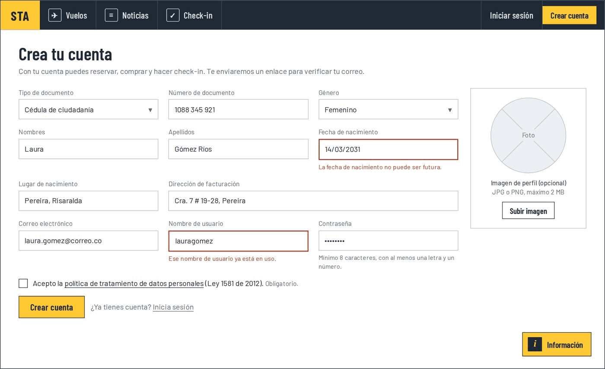

### HU-02 Verificar correo electrónico

| Campo | Valor |
|---|---|
| Número | HU-02 |
| Nombre | Verificar correo electrónico |
| Prioridad en Negocio | Alta |
| Responsable | Simón Londoño Escobar |
| Rol | Cliente |
| Iteración Asignada | 1 |

**Descripción:** Como cliente quiero verificar mi correo con un enlace para habilitar las reservas, las compras y la suscripción a noticias.

**Observaciones:**

- El enlace es de un solo uso y vale 24 horas. El cliente puede pedir que se reenvíe; el enlace anterior queda invalidado.
- Mientras no verifique el correo, la cuenta no puede reservar, comprar ni suscribirse a noticias.
- También aplica cuando el cliente cambia su correo desde el perfil (HU-07).
- Trazabilidad: CU-05 · RF-05.

**Criterio de Aceptación:**

- Abrir un enlace vigente marca el correo como verificado y habilita reservar, comprar y suscribirse.
- Un enlace vencido o ya usado muestra el error y la opción de reenviar.
- Al reenviar, el enlace anterior deja de funcionar.
- Un cliente sin verificar que intenta reservar o comprar es redirigido a la verificación.

**Mockup:** wireframe S02, Verificación de correo.

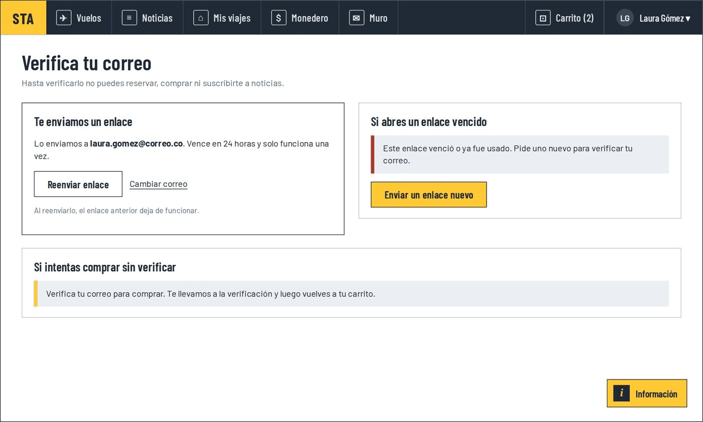

### HU-03 Iniciar sesión

| Campo | Valor |
|---|---|
| Número | HU-03 |
| Nombre | Iniciar sesión |
| Prioridad en Negocio | Alta |
| Responsable | Simón Londoño Escobar |
| Rol | Usuario registrado (cliente, administrador o root) |
| Iteración Asignada | 1 |

**Descripción:** Como usuario registrado quiero iniciar sesión con mi nombre de usuario (o correo) y mi contraseña para acceder a las funciones de mi rol.

**Observaciones:**

- Cada rol ve y puede usar solo sus funciones, según la matriz de permisos del SRS (Apéndice B). El control se hace en el servidor, no solo ocultando botones.
- La sesión expira tras 30 minutos de inactividad (15 minutos para administrador y root).
- Tras 5 intentos fallidos consecutivos, la cuenta se bloquea 15 minutos.
- El root es único, se crea en la instalación y solo tiene identificador y contraseña.
- Trazabilidad: CU-01 · RF-01, RF-06, RF-11, RNF-10, RNF-13, RNF-14.

**Criterio de Aceptación:**

- Con credenciales correctas, el usuario entra a la página de inicio de su rol.
- Con credenciales incorrectas, el mensaje es «usuario o contraseña incorrectos», sin revelar cuál de los dos falló.
- Después de 5 intentos fallidos, el sexto es rechazado aunque la contraseña sea correcta, y se informa el tiempo de espera.
- Una cuenta desactivada recibe el mensaje «cuenta inactiva».
- Tras el tiempo de inactividad, la siguiente acción pide iniciar sesión otra vez.
- Un administrador o el root que intenta reservar o comprar, incluso llamando directamente a la API, recibe un rechazo de autorización.

**Mockup:** wireframe S03, Inicio de sesión.

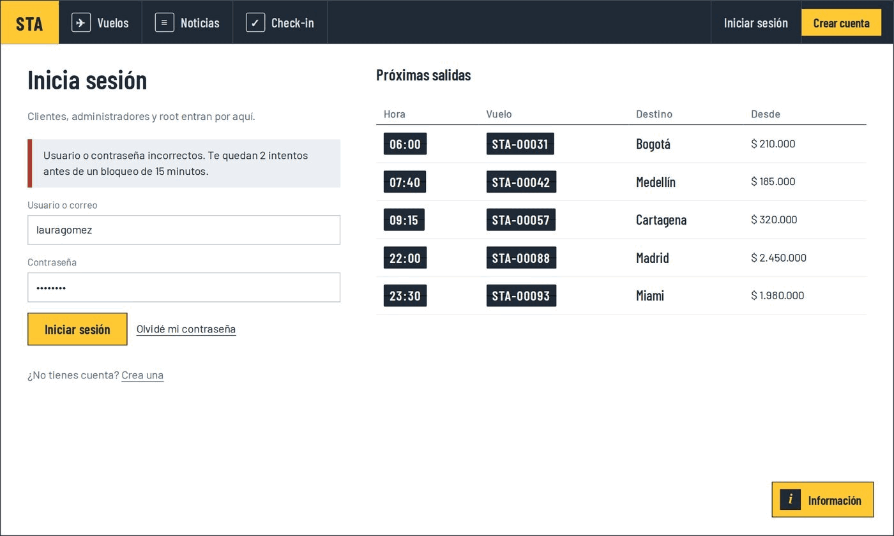

### HU-04 Cerrar sesión

| Campo | Valor |
|---|---|
| Número | HU-04 |
| Nombre | Cerrar sesión |
| Prioridad en Negocio | Alta |
| Responsable | Simón Londoño Escobar |
| Rol | Usuario registrado (cliente, administrador o root) |
| Iteración Asignada | 1 |

**Descripción:** Como usuario registrado quiero cerrar mi sesión para que nadie más use mi cuenta en ese dispositivo.

**Observaciones:**

- Disponible en cualquier momento desde el menú del rol.
- La sesión se invalida en el servidor, no solo en el navegador.
- Trazabilidad: CU-01 (flujo alterno \*a) · RF-06.

**Criterio de Aceptación:**

- Tras cerrar sesión se muestra la página pública de inicio.
- Cualquier petición posterior con la sesión anterior es rechazada y pide iniciar sesión.

**Mockup:** wireframe S05, Perfil y cuenta. Pantalla compartida con HU-06, HU-07, HU-08, HU-09, HU-45.

### HU-05 Restablecer contraseña

| Campo | Valor |
|---|---|
| Número | HU-05 |
| Nombre | Restablecer contraseña |
| Prioridad en Negocio | Alta |
| Responsable | Simón Londoño Escobar |
| Rol | Cliente o administrador |
| Iteración Asignada | 1 |

**Descripción:** Como cliente o administrador que olvidó su contraseña quiero definir una nueva mediante un enlace enviado a mi correo para volver a entrar a mi cuenta.

**Observaciones:**

- Las contraseñas no se recuperan: se restablecen (corrección del cliente en la reunión 1).
- El enlace es de un solo uso y vale 30 minutos.
- El mensaje en pantalla es el mismo exista o no el correo, para no revelar qué correos están registrados.
- El root no usa esta función: cambia su contraseña desde su sesión (HU-06).
- Trazabilidad: CU-02 · RF-07, RNF-08.

**Criterio de Aceptación:**

- Al solicitar el restablecimiento, la pantalla muestra el mismo mensaje exista o no el correo.
- Si el correo existe, llega un enlace que permite definir una contraseña nueva que cumpla la política.
- Un enlace vencido o ya usado muestra el error y permite solicitar otro.
- Tras restablecer, se cierran todas las sesiones abiertas del usuario y la contraseña anterior deja de funcionar.
- En ningún caso el sistema muestra ni envía la contraseña actual.

**Mockup:** wireframe S04, Restablecer contraseña.

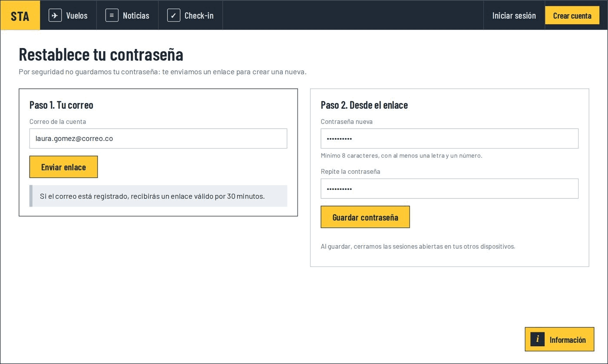

### HU-06 Cambiar contraseña

| Campo | Valor |
|---|---|
| Número | HU-06 |
| Nombre | Cambiar contraseña |
| Prioridad en Negocio | Alta |
| Responsable | Juan Camilo Murillo Ruiz |
| Rol | Usuario registrado (cliente, administrador o root) |
| Iteración Asignada | 1 |

**Descripción:** Como usuario registrado quiero cambiar mi contraseña indicando la actual para mantener segura mi cuenta.

**Observaciones:**

- Es la única forma en que el root cambia su contraseña.
- Política: mínimo 8 caracteres, al menos una letra y un número. Se guarda como hash, nunca en texto plano.
- Trazabilidad: CU-03 · RF-01, RF-08, RNF-08.

**Criterio de Aceptación:**

- Con la contraseña actual correcta y una nueva válida, el cambio se guarda y la anterior deja de funcionar.
- Si la contraseña actual es incorrecta, no se cambia nada.
- Una contraseña nueva que no cumple la política o no coincide con la confirmación es rechazada indicando el motivo.

**Mockup:** wireframe S05, Perfil y cuenta. Pantalla compartida con HU-04, HU-07, HU-08, HU-09, HU-45.

### HU-07 Editar perfil

| Campo | Valor |
|---|---|
| Número | HU-07 |
| Nombre | Editar perfil |
| Prioridad en Negocio | Alta |
| Responsable | Juan Camilo Murillo Ruiz |
| Rol | Cliente o administrador |
| Iteración Asignada | 1 |

**Descripción:** Como cliente o administrador quiero editar los datos de mi perfil para mantener mi información actualizada.

**Observaciones:**

- El tipo y número de documento y el nombre de usuario no se pueden editar, porque identifican la cuenta.
- Cambiar el correo exige verificar el nuevo (HU-02); mientras tanto sigue vigente el anterior.
- Los datos nuevos se usan en el autocompletado de viajeros de compras futuras; los tiquetes ya emitidos no cambian.
- El root no tiene perfil: solo cambia su contraseña.
- Trazabilidad: CU-06 · RF-08.

**Criterio de Aceptación:**

- Al volver a abrir el perfil se ven los datos actualizados.
- El documento y el nombre de usuario aparecen como solo lectura.
- Al cambiar el correo llega un enlace de verificación al correo nuevo, y el anterior sigue siendo el de la cuenta hasta que se verifique.
- Un correo que ya usa otra cuenta del mismo tipo es rechazado.

**Mockup:** wireframe S05, Perfil y cuenta. Pantalla compartida con HU-04, HU-06, HU-08, HU-09, HU-45.

### HU-08 Suscribirse a noticias

| Campo | Valor |
|---|---|
| Número | HU-08 |
| Nombre | Suscribirse a noticias |
| Prioridad en Negocio | Alta |
| Responsable | Juan Camilo Murillo Ruiz |
| Rol | Cliente |
| Iteración Asignada | 1 |

**Descripción:** Como cliente quiero suscribirme o darme de baja del sistema de noticias para recibir por correo los vuelos nuevos y las promociones.

**Observaciones:**

- Solo puede suscribirse un cliente con el correo verificado.
- Cada correo de noticias incluye un enlace para cancelar la suscripción y un enlace al vuelo.
- La opción para el correo semanal de recomendaciones se agrega en la iteración 4.
- Trazabilidad: CU-07, CU-20 · RF-09, RF-56, RNF-05.

**Criterio de Aceptación:**

- Un cliente suscrito recibe el correo de cada noticia nueva como máximo 5 minutos después de publicada.
- Un cliente no suscrito no recibe el correo.
- El enlace «cancelar suscripción» del correo da de baja al cliente sin necesidad de iniciar sesión.
- Un cliente con el correo sin verificar no puede suscribirse y se le ofrece reenviar la verificación.

**Mockup:** wireframe S05, Perfil y cuenta. Pantalla compartida con HU-04, HU-06, HU-07, HU-09, HU-45.

### HU-09 Desactivar cuenta

| Campo | Valor |
|---|---|
| Número | HU-09 |
| Nombre | Desactivar cuenta |
| Prioridad en Negocio | Media |
| Responsable | Juan Camilo Murillo Ruiz |
| Rol | Cliente |
| Iteración Asignada | 1 |

**Descripción:** Como cliente quiero desactivar mi cuenta para dejar de usar el servicio.

**Observaciones:**

- Es un borrado lógico: los datos, el histórico, el perfil de preferencias y el saldo del monedero se conservan.
- El sistema pide confirmación y advierte que no podrá volver a iniciar sesión.
- No se permite si el cliente tiene tiquetes o reservas activas en vuelos futuros.
- Trazabilidad: CU-08 · RF-10.

**Criterio de Aceptación:**

- Tras confirmar, la sesión se cierra y un nuevo inicio de sesión responde «cuenta inactiva».
- Los registros de la cuenta siguen en la base de datos, marcados como inactivos.
- Con reservas o tiquetes activos en vuelos futuros, la desactivación es rechazada y se listan cuáles debe cancelar o esperar.

**Mockup:** wireframe S05, Perfil y cuenta. Pantalla compartida con HU-04, HU-06, HU-07, HU-08, HU-45.

### HU-10 Crear administrador

| Campo | Valor |
|---|---|
| Número | HU-10 |
| Nombre | Crear administrador |
| Prioridad en Negocio | Alta |
| Responsable | Jesus David Villamil Angarita |
| Rol | Root |
| Iteración Asignada | 1 |

**Descripción:** Como root quiero crear cuentas de administrador con un nombre de usuario y una contraseña temporal para que el personal de la aerolínea pueda gestionar los vuelos.

**Observaciones:**

- Solo el root puede crear administradores.
- El administrador queda en estado «registro incompleto» hasta su primer ingreso (HU-12).
- La creación queda registrada en la auditoría.
- Trazabilidad: CU-09 · RF-01, RF-02, RF-26.

**Criterio de Aceptación:**

- El root crea un administrador con un nombre de usuario único y una contraseña que cumple la política.
- Un nombre de usuario que ya existe en el sistema es rechazado.
- Un usuario que no es root recibe un rechazo de autorización al intentar crear un administrador, incluso llamando directamente a la API.
- Ninguna interfaz permite crear un segundo root.

**Mockup:** wireframe S06, Gestión de administradores (root). Pantalla compartida con HU-11.

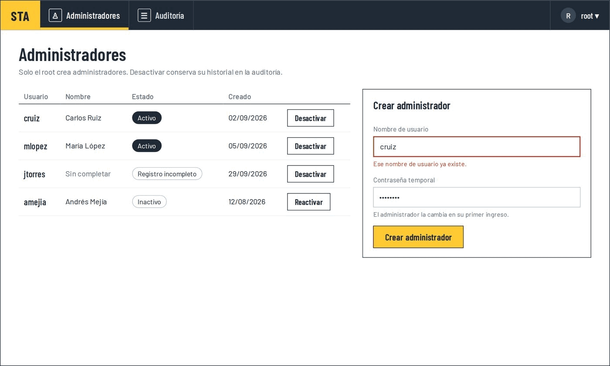

### HU-11 Desactivar o reactivar administrador

| Campo | Valor |
|---|---|
| Número | HU-11 |
| Nombre | Desactivar o reactivar administrador |
| Prioridad en Negocio | Alta |
| Responsable | Jesus David Villamil Angarita |
| Rol | Root |
| Iteración Asignada | 1 |

**Descripción:** Como root quiero desactivar o reactivar administradores para controlar quién gestiona el sistema.

**Observaciones:**

- Es un borrado lógico: las acciones pasadas del administrador se conservan en la auditoría.
- El sistema pide confirmación antes de desactivar.
- Cada desactivación o reactivación queda registrada en la auditoría.
- Trazabilidad: CU-10 · RF-02, RF-26.

**Criterio de Aceptación:**

- Un administrador desactivado que intenta iniciar sesión recibe «cuenta inactiva».
- Al reactivarlo, puede volver a iniciar sesión.
- La lista de administradores muestra el estado de cada uno: activo, inactivo o registro incompleto.

**Mockup:** wireframe S06, Gestión de administradores (root). Pantalla compartida con HU-10.

### HU-12 Completar registro de administrador

| Campo | Valor |
|---|---|
| Número | HU-12 |
| Nombre | Completar registro de administrador |
| Prioridad en Negocio | Alta |
| Responsable | Jesus David Villamil Angarita |
| Rol | Administrador |
| Iteración Asignada | 1 |

**Descripción:** Como administrador nuevo quiero completar mis datos y cambiar la contraseña temporal en mi primer ingreso para poder usar el sistema.

**Observaciones:**

- Se piden los mismos datos del registro de cliente (HU-01).
- El documento y el correo son únicos entre las cuentas de administrador; una misma persona puede tener además una cuenta de cliente.
- Trazabilidad: CU-11 · RF-02, RF-03, RF-04.

**Criterio de Aceptación:**

- Mientras el registro esté incompleto, el administrador solo ve el formulario de registro, aunque intente ir a otra función.
- Al completarlo, la contraseña temporal deja de funcionar y se muestra el menú de administrador.
- Un administrador puede registrarse luego como cliente con su mismo documento y otro nombre de usuario.

**Mockup:** wireframe S07, Primer ingreso del administrador.

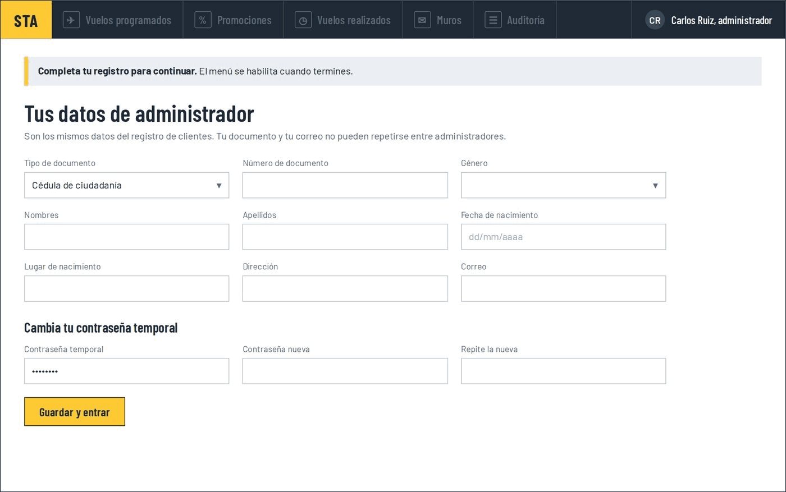

### HU-13 Programar vuelo

| Campo | Valor |
|---|---|
| Número | HU-13 |
| Nombre | Programar vuelo |
| Prioridad en Negocio | Alta |
| Responsable | Alejandro Osorio Osorio |
| Rol | Administrador |
| Iteración Asignada | 1 |

**Descripción:** Como administrador quiero programar un vuelo directo nacional o internacional para ponerlo a la venta.

**Observaciones:**

- Campos: fecha y hora de salida (hora local del origen), ciudad origen, ciudad destino, duración, precio en económica y precio en primera clase (COP). El código STA-nnnnn es autogenerado y nunca se reutiliza.
- Rutas: nacionales entre las 32 capitales departamentales; internacionales entre Pereira, Bogotá, Medellín, Cali o Cartagena y Madrid, Londres, Nueva York, Buenos Aires o Miami, en ambos sentidos.
- Capacidad automática: nacional 150 sillas (25 primera y 125 económica); internacional 250 (50 y 200).
- La llegada se calcula como salida en UTC más la duración, y se muestra en la hora local del destino, con horario de verano cuando aplica.
- Al guardar, se publica automáticamente la noticia del vuelo y un elemento del carrusel con una imagen de la ciudad destino. La creación queda en la auditoría.
- Trazabilidad: CU-13, CU-19 · RF-12 a RF-16, RF-22, RF-26.

**Criterio de Aceptación:**

- Pereira → Madrid y Madrid → Cartagena se aceptan; Manizales → Miami y Madrid → Londres se rechazan.
- Una salida en el pasado, una duración de 0 o de 24 horas o más, o un precio menor o igual a 0 son rechazados.
- Si ya existe un Pereira → Bogotá a las 06:00, otro el mismo día a las 06:00 es rechazado y uno a las 06:20 es aceptado.
- Bogotá → Madrid con salida el 10/07/2026 a las 22:00 y 10 h de duración muestra llegada el 11/07/2026 a las 15:00 Madrid (UTC+2); con salida el 10/12/2026 muestra 11/12/2026 14:00 Madrid (UTC+1).
- Crear un Pereira → Miami genera una noticia y un elemento del carrusel con una imagen de Miami.

**Mockup:** wireframe S08, Programar vuelo. Pantalla compartida con HU-14.

### HU-14 Programar vuelos recurrentes

| Campo | Valor |
|---|---|
| Número | HU-14 |
| Nombre | Programar vuelos recurrentes |
| Prioridad en Negocio | Media |
| Responsable | Alejandro Osorio Osorio |
| Rol | Administrador |
| Iteración Asignada | 1 |

**Descripción:** Como administrador quiero programar un vuelo que se repite a diario o en ciertos días de la semana para no tener que crear cada vuelo uno por uno.

**Observaciones:**

- Se indica el patrón (diario o días de la semana) y el periodo, con un horizonte máximo de 12 meses.
- Cada ocurrencia es un vuelo independiente, con su propio código y su propia noticia.
- Las fechas que chocan con un vuelo existente de la misma ruta y hora se omiten y se informan.
- Trazabilidad: CU-14 · RF-17.

**Criterio de Aceptación:**

- La serie «todos los lunes a las 06:00, Pereira → Bogotá, de octubre a diciembre de 2026» crea un vuelo por cada lunes del periodo.
- Un periodo de más de 12 meses, o con fecha de fin anterior a la de inicio, es rechazado.
- Editar o cancelar una ocurrencia no afecta a las demás.
- El resumen final lista los vuelos creados y las fechas omitidas con su motivo.

**Mockup:** wireframe S08, Programar vuelo. Pantalla compartida con HU-13.

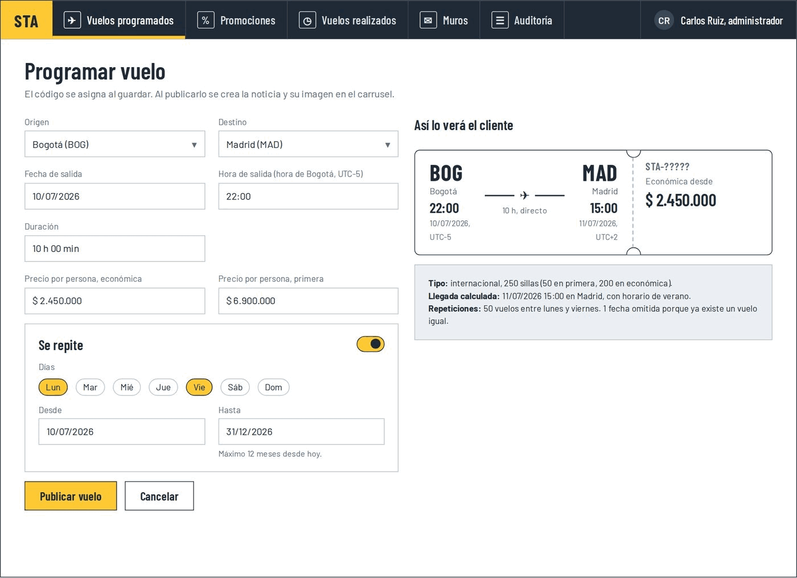

### HU-15 Editar vuelo

| Campo | Valor |
|---|---|
| Número | HU-15 |
| Nombre | Editar vuelo |
| Prioridad en Negocio | Alta |
| Responsable | Alejandro Osorio Osorio |
| Rol | Administrador |
| Iteración Asignada | 1 |

**Descripción:** Como administrador quiero editar un vuelo programado para corregir sus datos antes de que se venda.

**Observaciones:**

- Solo se puede editar si el vuelo no ha salido y no tiene ninguna compra ni ninguna reserva activa.
- Se vuelven a aplicar las validaciones de HU-13, y se recalculan el tipo, la capacidad y la llegada si cambian la ruta, la salida o la duración. El código se conserva.
- La auditoría guarda los valores anteriores y los nuevos.
- Trazabilidad: CU-15 · RF-18, RF-26.

**Criterio de Aceptación:**

- Si el vuelo tiene al menos una reserva activa o una compra, la edición se bloquea e indica el motivo.
- Si la única reserva del vuelo vence o se cancela, el vuelo vuelve a ser editable.
- Editar el precio de un vuelo deja en la auditoría el precio anterior y el nuevo.
- Un vuelo realizado o cancelado no se puede editar.

**Mockup:** wireframe S09, Vuelos programados (administrador). Pantalla compartida con HU-16.

### HU-16 Cancelar vuelo sin ventas

| Campo | Valor |
|---|---|
| Número | HU-16 |
| Nombre | Cancelar vuelo sin ventas |
| Prioridad en Negocio | Alta |
| Responsable | Jesus David Villamil Angarita |
| Rol | Administrador |
| Iteración Asignada | 1 |

**Descripción:** Como administrador quiero cancelar un vuelo que no tiene tiquetes vendidos para retirarlo de la venta.

**Observaciones:**

- Antes de confirmar, el sistema muestra cuántas reservas activas se anularán.
- Las reservas activas se anulan, sus sillas se liberan y sus clientes reciben un aviso por correo.
- El vuelo cancelado sale de la búsqueda y del carrusel; su código no se reutiliza. La cancelación queda en la auditoría.
- Un vuelo con tiquetes vendidos solo se puede cancelar por fuerza mayor (iteración 3).
- Trazabilidad: CU-16 · RF-19, RF-26.

**Criterio de Aceptación:**

- Tras cancelar, el vuelo no aparece en la búsqueda ni en el carrusel.
- Cada cliente con una reserva en el vuelo recibe un correo de anulación.
- Cancelar un vuelo ya realizado es rechazado.
- Si el vuelo tiene tiquetes vendidos, no se cancela y se indica que requiere cancelación por fuerza mayor.

**Mockup:** wireframe S09, Vuelos programados (administrador). Pantalla compartida con HU-15.

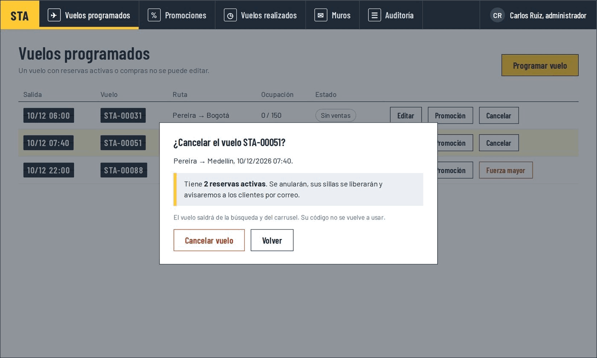

### HU-17 Crear promoción

| Campo | Valor |
|---|---|
| Número | HU-17 |
| Nombre | Crear promoción |
| Prioridad en Negocio | Alta |
| Responsable | Alejandro Osorio Osorio |
| Rol | Administrador |
| Iteración Asignada | 1 |

**Descripción:** Como administrador quiero crear una promoción para un vuelo que se está vendiendo mal para estimular que se venda completo.

**Observaciones:**

- Se define el porcentaje de descuento (1 % a 90 %), la clase o las clases a las que aplica y la fecha y hora de inicio y de fin.
- Aplica solo a las sillas disponibles de la clase y termina al llegar su fecha de fin o al agotarse esas sillas, lo que ocurra primero.
- Las promociones no se acumulan: un vuelo tiene como máximo una promoción vigente o programada por clase.
- El precio de las reservas y compras anteriores queda congelado. Se publica la noticia de la promoción y se destaca en el carrusel. Queda en la auditoría.
- Trazabilidad: CU-18, CU-19 · RF-23, RF-24, RF-25, RF-26.

**Criterio de Aceptación:**

- Durante la vigencia, la búsqueda muestra el precio de la clase menos el descuento e indica que hay promoción.
- Una segunda promoción para la misma clase de un vuelo con otra vigente o programada es rechazada.
- Al venderse la última silla disponible de la clase, la promoción pasa a «agotada» y sale del carrusel.
- No se puede crear una promoción para un vuelo que ya salió o está cancelado.
- Un tiquete comprado antes de la promoción no recibe ninguna devolución.

**Mockup:** wireframe S11, Crear promoción.

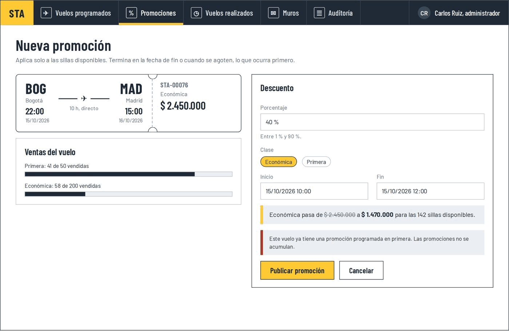

### HU-18 Consultar vuelos realizados

| Campo | Valor |
|---|---|
| Número | HU-18 |
| Nombre | Consultar vuelos realizados |
| Prioridad en Negocio | Alta |
| Responsable | Jesus David Villamil Angarita |
| Rol | Administrador |
| Iteración Asignada | 1 |

**Descripción:** Como administrador quiero consultar los vuelos ya realizados, con sus pasajeros y su ocupación, para conocer el resultado de cada vuelo.

**Observaciones:**

- Un proceso automático pasa a «realizado» cada vuelo no cancelado cuya hora de llegada ya se cumplió.
- Un vuelo realizado no se puede editar, cancelar, reservar ni comprar.
- La consulta tiene filtros por fecha, ruta y código.
- Trazabilidad: CU-21, CU-22 · RF-21, RNF-18.

**Criterio de Aceptación:**

- Como máximo 2 minutos después de su hora de llegada, el vuelo aparece como realizado y sale de la búsqueda pública.
- Si el servidor estuvo apagado, los vuelos cuya llegada pasó durante la caída se marcan como realizados al arrancar.
- El detalle de un vuelo realizado muestra sus pasajeros con su clase y su silla, y la ocupación por clase.

**Mockup:** wireframe S12, Vuelos realizados.

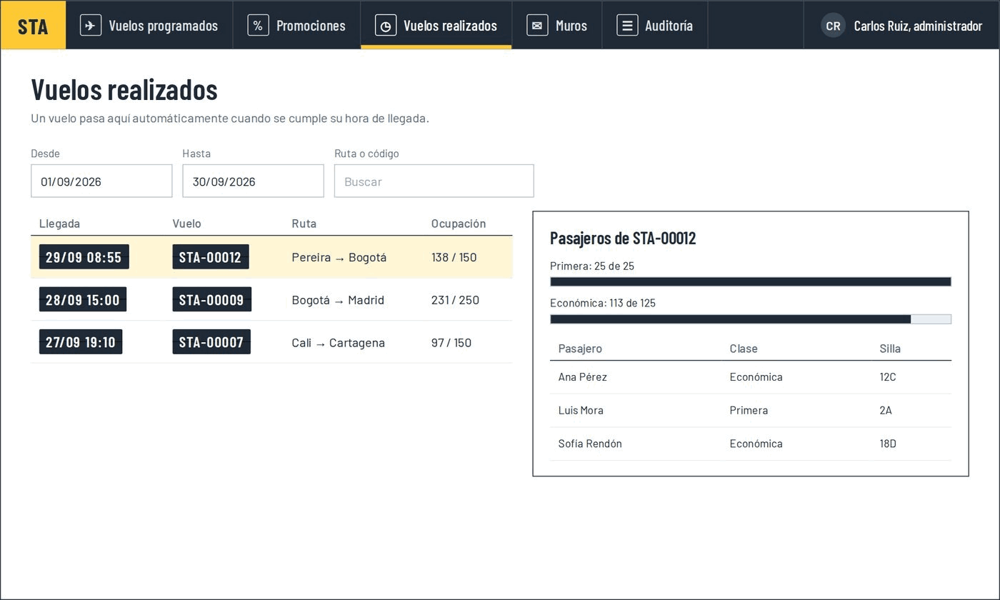

### HU-19 Consultar noticias y carrusel

| Campo | Valor |
|---|---|
| Número | HU-19 |
| Nombre | Consultar noticias y carrusel |
| Prioridad en Negocio | Alta |
| Responsable | Juan Camilo Murillo Ruiz |
| Rol | Visitante o cliente |
| Iteración Asignada | 1 |

**Descripción:** Como visitante o cliente quiero ver las noticias de vuelos nuevos y de promociones para enterarme de las ofertas de la aerolínea.

**Observaciones:**

- Las noticias son visibles sin iniciar sesión y se muestran de la más reciente a la más antigua, destacando las promociones vigentes.
- El carrusel, bajo la barra de navegación, muestra como máximo 10 elementos: primero las promociones vigentes y luego los vuelos más recientes.
- Las noticias son solo automáticas: los administradores no publican noticias manuales.
- Trazabilidad: CU-50 · RF-22, RF-25, RF-55.

**Criterio de Aceptación:**

- Un visitante sin sesión puede ver el listado de noticias y el carrusel.
- Al hacer clic en una noticia o en un elemento del carrusel se abre el detalle del vuelo.
- La noticia de una promoción vencida o agotada no aparece como vigente ni en el carrusel.
- Con más de 10 elementos posibles, el carrusel muestra solo 10, respetando el orden.
- No existe ninguna interfaz para crear noticias a mano.

**Mockup:** wireframe S13, Inicio público con carrusel y noticias.

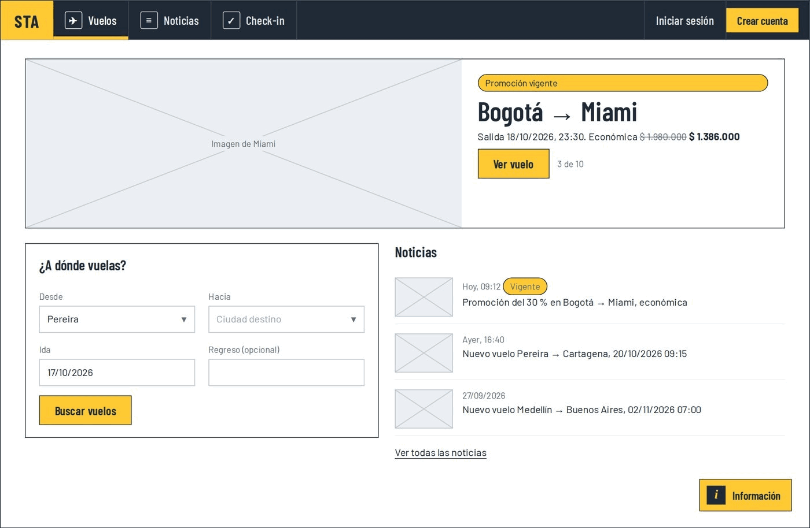

## Iteración 2

### HU-20 Buscar vuelos

| Campo | Valor |
|---|---|
| Número | HU-20 |
| Nombre | Buscar vuelos |
| Prioridad en Negocio | Alta |
| Responsable | Juan Camilo Murillo Ruiz |
| Rol | Visitante o cliente |
| Iteración Asignada | 2 |

**Descripción:** Como visitante o cliente quiero buscar vuelos por cualquier criterio o combinación de criterios para encontrar el vuelo que me sirve.

**Observaciones:**

- Criterios: código, origen, destino, tipo (nacional o internacional), rango de fechas, rango de horas, rango de duración, rango de precio y clase. Los filtros se combinan: todos deben cumplirse.
- Cada resultado muestra código, ruta, salida y llegada en hora local, duración, precio vigente por clase (indicando si hay promoción) y disponibilidad por clase. Los vuelos sin cupo aparecen como «agotado».
- Orden por precio ascendente (se puede cambiar a fecha o duración), 20 resultados por página.
- Las búsquedas de un cliente autenticado se registran para la recomendación; las de un visitante no.
- Trazabilidad: CU-23 · RF-27, RF-29, RF-60, RNF-01.

**Criterio de Aceptación:**

- «Vuelos desde Pereira con precio entre $ 200.000 y $ 400.000» devuelve solo vuelos que cumplen ambas condiciones.
- Los vuelos realizados o cancelados no aparecen en los resultados.
- Un rango inválido (mínimo mayor que el máximo, o fecha final anterior a la inicial) muestra el error.
- Una búsqueda sin sesión no crea registros asociados a ningún usuario; la de un cliente autenticado sí.
- Con 100 usuarios concurrentes, el 95 % de las búsquedas responde en 2 segundos o menos (RNF-01).

**Mockup:** wireframe S14, Resultados de búsqueda.

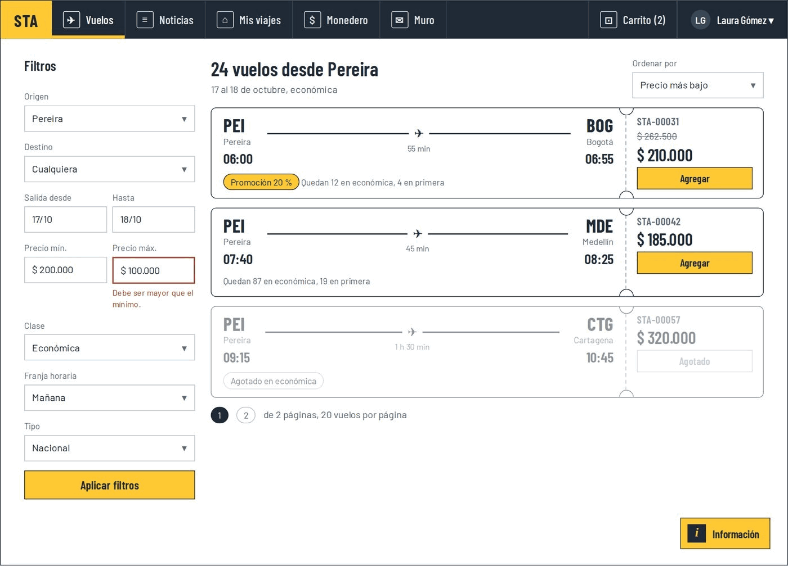

### HU-21 Buscar ida y regreso

| Campo | Valor |
|---|---|
| Número | HU-21 |
| Nombre | Buscar ida y regreso |
| Prioridad en Negocio | Alta |
| Responsable | Juan Camilo Murillo Ruiz |
| Rol | Visitante o cliente |
| Iteración Asignada | 2 |

**Descripción:** Como visitante o cliente quiero buscar un vuelo de ida y uno de regreso, incluso con regreso a otra ciudad, para armar un trayecto completo.

**Observaciones:**

- Se indican ciudad de salida, ciudad de destino, ciudad de regreso (puede ser distinta de la de salida), fecha de ida y fecha de regreso.
- Primero se eligen los vuelos de ida; luego solo se ofrecen regresos que salen después de la llegada del vuelo de ida elegido.
- El precio total es la suma de los precios vigentes de ambos vuelos, sin descuento combinado.
- Trazabilidad: CU-24 · RF-28, RF-40.

**Criterio de Aceptación:**

- Si el vuelo de ida elegido llega el 10/12 a las 16:30, no se ofrece ningún regreso que salga antes de esa hora.
- Se puede armar el trayecto Pereira → Nueva York → Cartagena.
- Una fecha de regreso anterior a la de ida es rechazada.
- Si no hay regresos para esa fecha, se informa y se puede cambiar la fecha o la ciudad de regreso.

**Mockup:** wireframe S15, Búsqueda de ida y regreso. Pantalla compartida con HU-26.

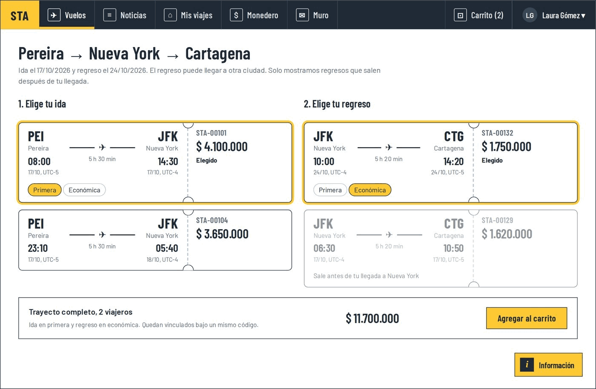

### HU-22 Agregar vuelos al carrito

| Campo | Valor |
|---|---|
| Número | HU-22 |
| Nombre | Agregar vuelos al carrito |
| Prioridad en Negocio | Alta |
| Responsable | Juan Camilo Murillo Ruiz |
| Rol | Cliente |
| Iteración Asignada | 2 |

**Descripción:** Como cliente quiero agregar vuelos al carrito con la clase y la cantidad de viajeros para decidir después si los reservo o los compro.

**Observaciones:**

- Se puede agregar un trayecto único o completo. El carrito persiste entre sesiones y admite vuelos de rutas distintas.
- En el carrito las sillas no se bloquean; se bloquean solo al iniciar el pago (HU-25).
- Al agregar se valida el cupo en la clase y el máximo de 5 tiquetes activos del cliente por vuelo (compras y reservas).
- Trazabilidad: CU-25 · RF-30, RF-32, RF-33.

**Criterio de Aceptación:**

- Una selección agregada sigue en el carrito después de cerrar sesión y volver a entrar.
- Si la clase elegida está agotada, la selección no se agrega y se informa.
- Un cliente con 3 tiquetes comprados y 2 reservados en un vuelo no puede agregar otro tiquete de ese vuelo.

**Mockup:** wireframe S16, Carrito. Pantalla compartida con HU-23.

### HU-23 Revisar y modificar el carrito

| Campo | Valor |
|---|---|
| Número | HU-23 |
| Nombre | Revisar y modificar el carrito |
| Prioridad en Negocio | Alta |
| Responsable | Juan Camilo Murillo Ruiz |
| Rol | Cliente |
| Iteración Asignada | 2 |

**Descripción:** Como cliente quiero revisar, modificar y vaciar mi carrito para confirmar solo lo que realmente voy a reservar o comprar.

**Observaciones:**

- El carrito muestra cada selección con su precio vigente y su disponibilidad actual.
- Se puede cambiar la clase o la cantidad de viajeros, eliminar selecciones o vaciar el carrito.
- Desde el carrito se confirma cada selección como reserva (HU-24) o como compra (HU-25).
- Trazabilidad: CU-25 · RF-30.

**Criterio de Aceptación:**

- Si el precio de una selección cambió (por ejemplo, por una promoción), el sistema lo advierte antes de confirmar.
- Si una selección se quedó sin disponibilidad, el sistema lo advierte y no permite confirmarla.
- Eliminar una selección o vaciar el carrito se refleja de inmediato.

**Mockup:** wireframe S16, Carrito. Pantalla compartida con HU-22.

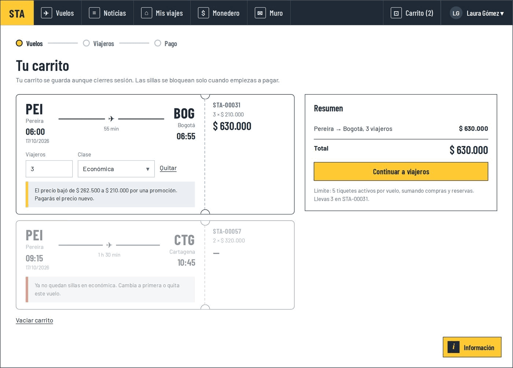

### HU-24 Reservar tiquetes

| Campo | Valor |
|---|---|
| Número | HU-24 |
| Nombre | Reservar tiquetes |
| Prioridad en Negocio | Alta |
| Responsable | Simón Londoño Escobar |
| Rol | Cliente |
| Iteración Asignada | 2 |

**Descripción:** Como cliente quiero reservar tiquetes sin pagar para asegurar las sillas y el precio mientras decido.

**Observaciones:**

- Requiere el correo verificado. Por cada viajero se registran tipo y número de documento, nombres, apellidos, fecha de nacimiento, género, teléfono, correo, nombre y teléfono de un contacto, y la clase. Si el cliente viaja, sus datos se autocompletan.
- Reglas: máximo 5 tiquetes activos por cliente y vuelo; cupo por clase; un viajero no puede tener dos tiquetes activos en el mismo vuelo; un menor (edad calculada a la fecha del vuelo) solo viaja si hay un adulto en la misma reserva y vuelo.
- Las sillas se asignan automáticamente: al azar, pero en un bloque contiguo de la misma fila por cada clase. El precio queda congelado.
- La reserva vence a las 24 horas o en el límite de cancelación del vuelo (1 h antes de la salida si es nacional, 3 h si es internacional), lo que ocurra primero. Al vencer, un proceso automático la marca «vencida», libera las sillas y avisa al cliente por correo.
- Mientras exista una reserva activa, el vuelo no se puede editar.
- Trazabilidad: CU-26, CU-28, CU-29, CU-35 · RF-31 a RF-37, RF-41, RF-42.

**Criterio de Aceptación:**

- Una reserva hecha 10 horas antes de un vuelo nacional vence 1 hora antes de la salida.
- Mientras la reserva está vigente, sus sillas no están disponibles para otros clientes.
- Una reserva de 3 viajeros en económica en un vuelo nacional vacío recibe 3 sillas contiguas de una misma fila; repetida en vuelos vacíos, el bloque queda en posiciones distintas.
- Una reserva con un único viajero de 16 años es rechazada; un viajero que cumple 18 años antes de la fecha del vuelo puede viajar solo.
- Un documento que ya tiene un tiquete activo en el vuelo es rechazado, sin revelar quién hizo la otra compra.
- Como máximo 2 minutos después del vencimiento, la reserva queda «vencida», sus sillas se liberan y el cliente recibe el correo.

**Mockup:** wireframe S17, Datos de viajeros y elección reservar o comprar.

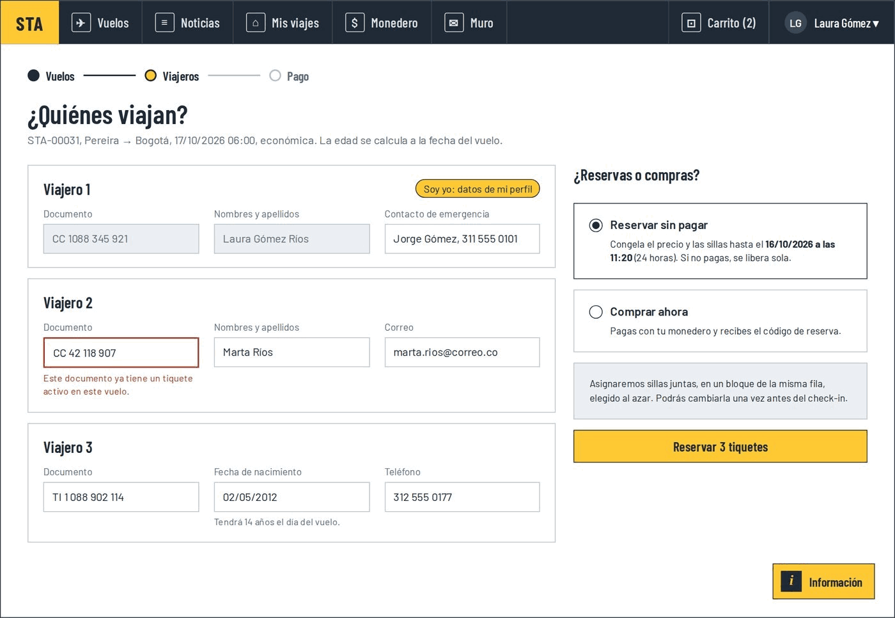

### HU-25 Comprar tiquetes

| Campo | Valor |
|---|---|
| Número | HU-25 |
| Nombre | Comprar tiquetes |
| Prioridad en Negocio | Alta |
| Responsable | Jesus David Villamil Angarita |
| Rol | Cliente |
| Iteración Asignada | 2 |

**Descripción:** Como cliente quiero comprar tiquetes pagando con el saldo de mi monedero para asegurar mi viaje.

**Observaciones:**

- Requiere el correo verificado. Se registran los viajeros y se aplican las mismas reglas de HU-24.
- El pago es solo con el monedero simulado; no hay pasarela ni conexión con bancos. Al iniciar el pago, las sillas se bloquean durante 15 minutos.
- El descuento del saldo, la asignación de sillas y la emisión de los tiquetes ocurren en una sola transacción: o suceden todos o ninguno.
- Al confirmar, se genera un código de reserva alfanumérico de 6 caracteres, se envía a cada viajero y el comprador recibe el comprobante en PDF.
- Si el saldo no alcanza, se ofrece recargar (HU-30). Si dos clientes compiten por las últimas sillas, las obtiene el primero en confirmar.
- Trazabilidad: CU-27, CU-28, CU-29, CU-30 · RF-24, RF-31 a RF-35, RF-39, RF-41, RF-42, RNF-17.

**Criterio de Aceptación:**

- Con un saldo de $ 1.000.000, una compra de $ 800.000 deja el saldo en $ 200.000 y registra el movimiento.
- Con un saldo de $ 500.000, una compra de $ 800.000 es rechazada y no se asigna ninguna silla.
- Cada viajero con correo recibe el código de reserva, y el comprador recibe el comprobante en PDF.
- Si el cliente no confirma en 15 minutos, las sillas bloqueadas se liberan.
- Con 50 compras simultáneas por la última silla, exactamente una tiene éxito y a las demás no se les descuenta saldo.
- Una compra con 2 viajeros en primera y 3 en económica recibe un bloque de sillas en cada clase.

**Mockup:** wireframe S18, Pago con monedero.

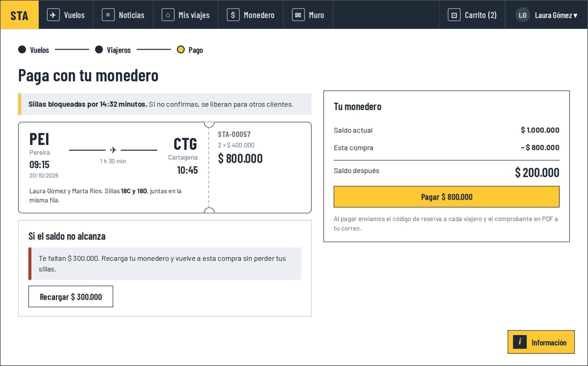

### HU-26 Reservar o comprar un trayecto completo

| Campo | Valor |
|---|---|
| Número | HU-26 |
| Nombre | Reservar o comprar un trayecto completo |
| Prioridad en Negocio | Alta |
| Responsable | Jesus David Villamil Angarita |
| Rol | Cliente |
| Iteración Asignada | 2 |

**Descripción:** Como cliente quiero reservar o comprar la ida y el regreso en una sola operación para tener todo mi viaje bajo un mismo código.

**Observaciones:**

- Un trayecto completo es una sola reserva o compra, con código común y dos tiquetes vinculados por viajero (ida y regreso).
- La ciudad de regreso puede ser distinta de la de salida. La clase se elige por separado en cada tramo.
- El precio es la suma de los precios vigentes de ambos vuelos, sin descuento combinado. Las reglas de HU-24 y HU-25 se validan en cada tramo.
- La cancelación de un trayecto completo se trata en la iteración 3.
- Trazabilidad: CU-24, CU-26, CU-27 · RF-40.

**Criterio de Aceptación:**

- Un Pereira → Nueva York en primera y un Nueva York → Cartagena en económica suman sus precios y quedan vinculados bajo un mismo código de reserva.
- Cada viajero queda con dos tiquetes, uno por tramo, con silla asignada en cada vuelo.
- Si uno de los tramos incumple una regla (cupo, límite de 5 tiquetes, menores), no se crea ninguno de los dos.

**Mockup:** wireframe S15, Búsqueda de ida y regreso. Pantalla compartida con HU-21.

### HU-27 Pagar una reserva

| Campo | Valor |
|---|---|
| Número | HU-27 |
| Nombre | Pagar una reserva |
| Prioridad en Negocio | Alta |
| Responsable | Simón Londoño Escobar |
| Rol | Cliente |
| Iteración Asignada | 2 |

**Descripción:** Como cliente quiero pagar una reserva vigente al precio congelado para convertirla en compra antes de que venza.

**Observaciones:**

- Se paga desde «Mis reservas», completa o por viajero.
- Si paga solo algunos viajeros, los demás siguen reservados con el mismo vencimiento (supuesto del equipo).
- Al pagar se aplican los mismos efectos de la compra (HU-25): código de reserva, correos, comprobante en PDF y movimiento en el monedero. Las sillas de la reserva se conservan.
- Trazabilidad: CU-31 · RF-38, RF-39.

**Criterio de Aceptación:**

- El pago cobra el precio congelado de la reserva, aunque después se haya creado una promoción para ese vuelo.
- Pagar 2 de 4 viajeros deja 2 tiquetes comprados y 2 reservados con el mismo vencimiento.
- Intentar pagar una reserva vencida o cancelada es rechazado.
- Las sillas asignadas en la reserva son las mismas de la compra.

**Mockup:** wireframe S19, Mis viajes: compras y reservas. Pantalla compartida con HU-35, HU-36.

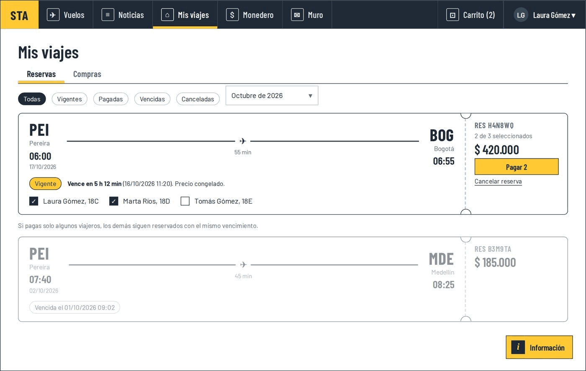

### HU-28 Registrar tarjeta

| Campo | Valor |
|---|---|
| Número | HU-28 |
| Nombre | Registrar tarjeta |
| Prioridad en Negocio | Alta |
| Responsable | Alejandro Osorio Osorio |
| Rol | Cliente |
| Iteración Asignada | 2 |

**Descripción:** Como cliente quiero registrar una tarjeta de crédito o débito simulada para poder recargar mi monedero.

**Observaciones:**

- Datos: tipo (crédito o débito), franquicia, nombre del titular, número, fecha de vencimiento y CVV.
- El número se valida con el algoritmo de Luhn. Solo se guardan los últimos 4 dígitos y un token simulado; el CVV se valida pero nunca se almacena.
- La tarjeta se muestra enmascarada (p. ej. \*\*\*\* 1234).
- Trazabilidad: CU-40 · RF-46, RNF-12.

**Criterio de Aceptación:**

- Un número que no pasa el algoritmo de Luhn es rechazado.
- Una tarjeta vencida es rechazada.
- Después de registrar 20 tarjetas de prueba, la base de datos y los logs no contienen ningún número completo ni ningún CVV.

**Mockup:** wireframe S23, Registrar tarjeta y recargar. Pantalla compartida con HU-30.

### HU-29 Eliminar tarjeta

| Campo | Valor |
|---|---|
| Número | HU-29 |
| Nombre | Eliminar tarjeta |
| Prioridad en Negocio | Media |
| Responsable | Alejandro Osorio Osorio |
| Rol | Cliente |
| Iteración Asignada | 2 |

**Descripción:** Como cliente quiero eliminar una tarjeta registrada para conservar solo las que uso.

**Observaciones:**

- El sistema pide confirmación antes de eliminar.
- Los movimientos históricos hechos con la tarjeta conservan su referencia.
- Trazabilidad: CU-41 · RF-46.

**Criterio de Aceptación:**

- La tarjeta eliminada ya no aparece como opción para recargar.
- Los movimientos de recarga hechos con ella siguen mostrando su referencia (\*\*\*\* 1234).

**Mockup:** wireframe S22, Monedero: saldo, tarjetas y movimientos. Pantalla compartida con HU-31.

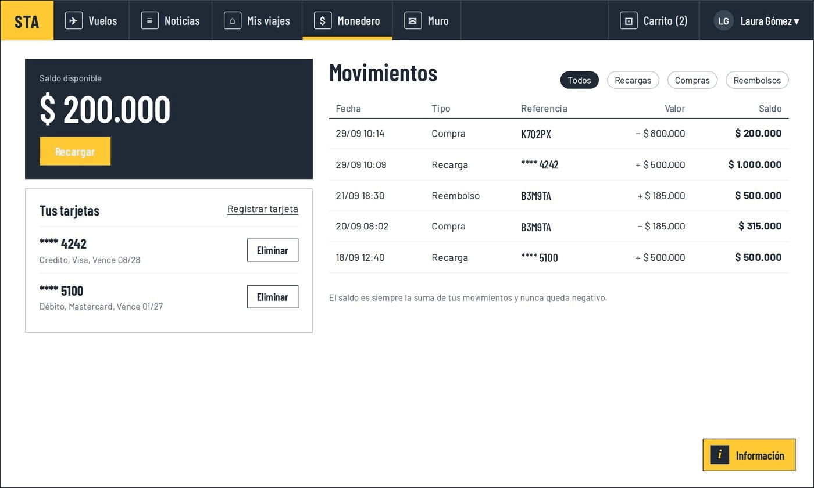

### HU-30 Recargar monedero

| Campo | Valor |
|---|---|
| Número | HU-30 |
| Nombre | Recargar monedero |
| Prioridad en Negocio | Alta |
| Responsable | Alejandro Osorio Osorio |
| Rol | Cliente |
| Iteración Asignada | 2 |

**Descripción:** Como cliente quiero recargar mi monedero desde una tarjeta registrada para tener saldo con qué comprar.

**Observaciones:**

- La recarga se aprueba de forma simulada si la tarjeta está vigente. No hay tope de recarga. El valor debe ser un entero mayor que 0.
- Si el cliente llega desde una compra con saldo insuficiente, se le muestra el valor faltante y, al terminar, vuelve a la compra.
- Si no tiene tarjetas registradas, se le pide registrar una (HU-28).
- Trazabilidad: CU-42 · RF-47, RF-48.

**Criterio de Aceptación:**

- Una recarga de $ 500.000 aumenta el saldo exactamente en $ 500.000 y registra el movimiento con la referencia de la tarjeta.
- Una recarga con una tarjeta vencida o con un valor menor o igual a 0 es rechazada.
- Desde una compra con saldo insuficiente, después de recargar el cliente vuelve a la confirmación de la compra.

**Mockup:** wireframe S23, Registrar tarjeta y recargar. Pantalla compartida con HU-28.

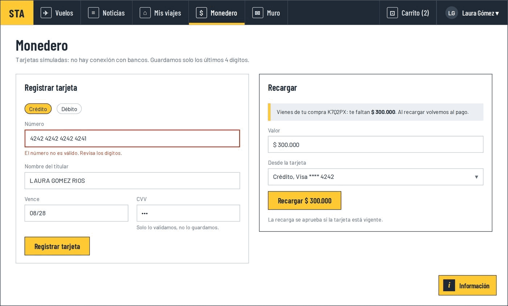

### HU-31 Consultar saldo y movimientos

| Campo | Valor |
|---|---|
| Número | HU-31 |
| Nombre | Consultar saldo y movimientos |
| Prioridad en Negocio | Alta |
| Responsable | Alejandro Osorio Osorio |
| Rol | Cliente |
| Iteración Asignada | 2 |

**Descripción:** Como cliente quiero ver mi saldo y mis movimientos para controlar en qué se ha usado mi dinero.

**Observaciones:**

- Los movimientos se muestran del más reciente al más antiguo: fecha, tipo (recarga, compra o reembolso), referencia (código de reserva o tarjeta), valor y saldo resultante.
- Hay filtros por tipo y por fecha. El saldo nunca puede quedar negativo.
- Valores en COP con separador de miles de punto y sin decimales.
- Trazabilidad: CU-43 · RF-48, RNF-17.

**Criterio de Aceptación:**

- El saldo mostrado es igual a la suma de todos los movimientos del cliente.
- Un cliente sin movimientos ve saldo $ 0 y la opción de recargar.
- Filtrar por tipo «recarga» muestra solo las recargas.

**Mockup:** wireframe S22, Monedero: saldo, tarjetas y movimientos. Pantalla compartida con HU-29.

## Iteración 3

### HU-32 Cancelar vuelo por fuerza mayor

| Campo | Valor |
|---|---|
| Número | HU-32 |
| Nombre | Cancelar vuelo por fuerza mayor |
| Prioridad en Negocio | Alta |
| Responsable | Jesus David Villamil Angarita |
| Rol | Administrador |
| Iteración Asignada | 3 |

**Descripción:** Como administrador quiero cancelar un vuelo con tiquetes vendidos cuando ocurre un evento de fuerza mayor para proteger a los pasajeros y ofrecerles una salida.

**Observaciones:**

- Fuerza mayor: evento externo a la aerolínea (desastre natural, protesta, huelga, obstrucción de pista). El motivo es obligatorio.
- Antes de confirmar, el sistema muestra cuántos tiquetes y reservas se verán afectados.
- Todos los tiquetes del vuelo pasan a «pendiente de decisión», y cada cliente comprador y cada viajero reciben un correo. El cliente decide entre reembolso y reubicación (HU-33).
- Las reservas sin pagar del vuelo se anulan, se liberan sus sillas y se avisa al cliente.
- Si el cliente no decide en 48 horas, un proceso automático reembolsa el 100 % de lo pagado a su monedero.
- La cancelación y su motivo quedan en la auditoría.
- Trazabilidad: CU-17, CU-38 · RF-20, RF-26, RNF-18, SUP-03, SUP-04.

**Criterio de Aceptación:**

- Tras la cancelación, ningún tiquete del vuelo queda activo: todos están como «pendiente de decisión», «reembolsado» o «reubicado».
- Cada cliente comprador y cada viajero con correo reciben el aviso de cancelación con el motivo.
- Cancelar sin motivo es rechazado.
- Si un cliente no decide, como máximo 2 minutos después de cumplidas las 48 horas su monedero recibe el reembolso por el valor exacto pagado.
- Un vuelo realizado no se puede cancelar.

**Mockup:** wireframe S10, Cancelación por fuerza mayor.

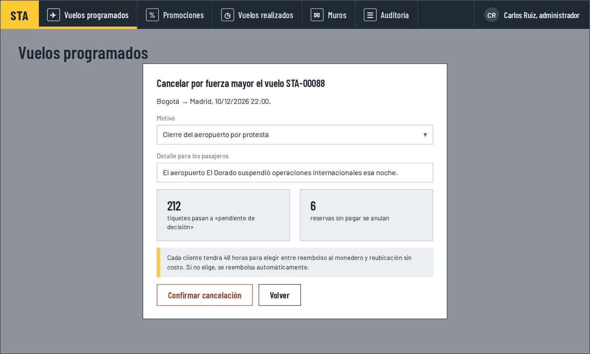

### HU-33 Decidir entre reembolso o reubicación

| Campo | Valor |
|---|---|
| Número | HU-33 |
| Nombre | Decidir entre reembolso o reubicación |
| Prioridad en Negocio | Alta |
| Responsable | Jesus David Villamil Angarita |
| Rol | Cliente |
| Iteración Asignada | 3 |

**Descripción:** Como cliente con un tiquete de un vuelo cancelado por fuerza mayor quiero elegir entre el reembolso y la reubicación en otro vuelo para no perder mi dinero ni mi viaje.

**Observaciones:**

- La decisión se toma desde la cuenta, por cada tiquete, dentro de las 48 horas siguientes al aviso.
- Reembolso: se abona al monedero el 100 % de lo pagado por ese tiquete.
- Reubicación: el sistema ofrece vuelos de la misma ruta, que salen después del vuelo cancelado y con cupo en la misma clase, sin costo adicional. La silla se asigna con el mismo algoritmo agrupado de la compra.
- Si el tiquete es la ida de un trayecto completo, el cliente decide también si conserva o no el regreso.
- Si no hay vuelos alternativos con cupo, solo se ofrece el reembolso.
- Trazabilidad: CU-34, CU-36, CU-37 · RF-20, RF-24, RF-41, RF-48.

**Criterio de Aceptación:**

- Al elegir reembolso, el monedero muestra un movimiento de tipo «reembolso» por el valor exacto pagado, incluido el descuento de la promoción si la hubo.
- Al elegir reubicación, el viajero queda con un tiquete en el vuelo alternativo, con silla asignada y sin ningún cobro, y recibe el detalle por correo.
- Solo se ofrecen vuelos alternativos de la misma ruta, posteriores al cancelado y con cupo en la clase del tiquete.
- Pasadas las 48 horas, la opción de decidir ya no aparece y el tiquete figura como «reembolsado».

**Mockup:** wireframe S21, Decidir entre reembolso o reubicación.

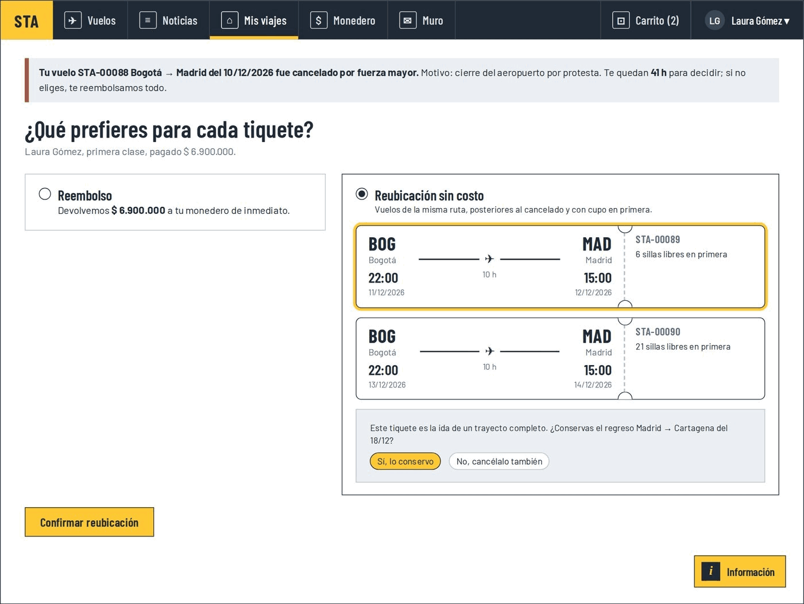

### HU-34 Cancelar compra

| Campo | Valor |
|---|---|
| Número | HU-34 |
| Nombre | Cancelar compra |
| Prioridad en Negocio | Alta |
| Responsable | Simón Londoño Escobar |
| Rol | Cliente |
| Iteración Asignada | 3 |

**Descripción:** Como cliente quiero cancelar una compra completa o los tiquetes de algunos viajeros para recuperar mi dinero cuando ya no voy a viajar.

**Observaciones:**

- Plazo: hasta 1 hora antes de la salida si el vuelo es nacional y hasta 3 horas antes si es internacional.
- Se reembolsa al monedero el 100 % de lo pagado por los tiquetes cancelados, y sus sillas se liberan.
- No se puede cancelar un tiquete con check-in.
- Trayecto completo: cancelar la ida cancela también el regreso; cancelar solo el regreso no afecta la ida. Las compras separadas son independientes.
- Si la compra incluye menores, cancelar al último adulto exige cancelar también a los menores.
- El sistema pide confirmación y muestra el valor que se reembolsará.
- Trazabilidad: CU-32, CU-34 · RF-35, RF-43, RF-48.

**Criterio de Aceptación:**

- Para un vuelo nacional que sale a las 12:00, cancelar a las 10:59 es aceptado y a las 11:05 es rechazado.
- Un vuelo internacional que sale a las 20:00 se puede cancelar hasta las 17:00.
- Cancelar la ida de un trayecto completo deja ambos tiquetes cancelados y reembolsados.
- Cancelar un tiquete con check-in es rechazado.
- Cancelar al último adulto de una compra con menores es rechazado, salvo que se cancelen también los menores.
- El monedero muestra el reembolso por el valor exacto pagado, y las sillas quedan disponibles de inmediato.

**Mockup:** wireframe S20, Cancelar compra.

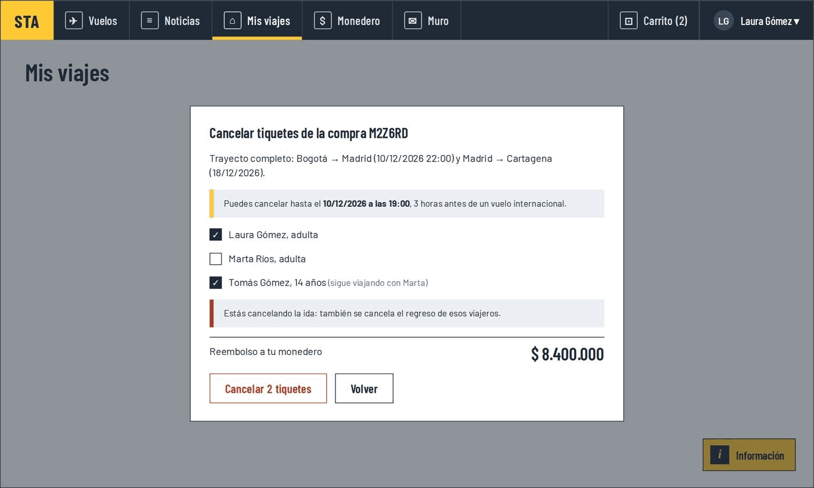

### HU-35 Cancelar reserva

| Campo | Valor |
|---|---|
| Número | HU-35 |
| Nombre | Cancelar reserva |
| Prioridad en Negocio | Alta |
| Responsable | Simón Londoño Escobar |
| Rol | Cliente |
| Iteración Asignada | 3 |

**Descripción:** Como cliente quiero cancelar una reserva que ya no voy a pagar para liberar las sillas.

**Observaciones:**

- Se puede cancelar en cualquier momento antes del vencimiento. Cancelar una reserva tiene el mismo efecto que dejarla vencer: liberar las sillas.
- No hay movimiento en el monedero, porque no hubo pago.
- Si era la única reserva del vuelo y el vuelo no tiene compras, el vuelo vuelve a ser editable por el administrador.
- Trazabilidad: CU-33 · RF-18, RF-44.

**Criterio de Aceptación:**

- La reserva queda en estado «cancelada» y sus sillas vuelven a estar disponibles de inmediato.
- El saldo del monedero no cambia.
- Una reserva vencida, pagada o ya cancelada no se puede cancelar.

**Mockup:** wireframe S19, Mis viajes: compras y reservas. Pantalla compartida con HU-27, HU-36.

### HU-36 Consultar histórico

| Campo | Valor |
|---|---|
| Número | HU-36 |
| Nombre | Consultar histórico |
| Prioridad en Negocio | Alta |
| Responsable | Jesus David Villamil Angarita |
| Rol | Cliente |
| Iteración Asignada | 3 |

**Descripción:** Como cliente quiero consultar el histórico de mis compras y reservas para saber el estado de cada una.

**Observaciones:**

- Estados de las compras: activas, canceladas, realizadas, reembolsadas y reubicadas. Estados de las reservas: vigentes, pagadas, vencidas y canceladas.
- Filtros por estado y por fecha. Desde el detalle se accede a las acciones disponibles (pagar, cancelar, check-in, cambiar silla).
- Los vuelos realizados aparecen en el histórico.
- Trazabilidad: CU-39 · RF-21, RF-45.

**Criterio de Aceptación:**

- Una compra cancelada aparece con la fecha de cancelación y el valor reembolsado.
- Filtrar por «vencidas» muestra solo las reservas vencidas.
- El detalle de una compra muestra vuelos, viajeros, clase, sillas, valores pagados y código de reserva.

**Mockup:** wireframe S19, Mis viajes: compras y reservas. Pantalla compartida con HU-27, HU-35.

### HU-37 Hacer check-in rápido

| Campo | Valor |
|---|---|
| Número | HU-37 |
| Nombre | Hacer check-in rápido |
| Prioridad en Negocio | Alta |
| Responsable | Alejandro Osorio Osorio |
| Rol | Viajero (registrado o no) |
| Iteración Asignada | 3 |

**Descripción:** Como viajero quiero hacer el check-in con mi código de reserva o mi documento, sin iniciar sesión, para obtener mi pasabordo.

**Observaciones:**

- Ventana: se abre 24 horas antes de la salida y se cierra 1 hora antes. Fuera de ella, el sistema informa cuándo abre o que ya cerró.
- Con el código de reserva se ven los viajeros de esa compra; con el documento, solo los tiquetes propios dentro de la ventana. Solo aplica a tiquetes pagados.
- Antes de confirmar, el viajero puede cambiar o confirmar su silla (HU-39). Después del check-in no se puede cambiar la silla ni cancelar el tiquete.
- Al confirmar, se genera el pasabordo en PDF y se envía al correo del viajero: nombre, documento, código de vuelo, origen, destino, fecha, salida y llegada en hora local, duración, clase, silla (fila y letra), código de reserva y un QR. No incluye puerta de embarque.
- Por seguridad, se admiten como máximo 10 consultas fallidas por IP en 10 minutos.
- Trazabilidad: CU-44, CU-45, CU-47 · RF-49, RF-50, RF-52, RNF-13.

**Criterio de Aceptación:**

- Para un vuelo que sale el 10/12 a las 08:00, el check-in está disponible desde el 09/12 a las 08:00 hasta el 10/12 a las 07:00.
- Un código inexistente o un documento sin tiquetes en la ventana muestra «no se encontraron tiquetes para check-in».
- Tras confirmar, el viajero recibe el pasabordo en PDF, y el QR, al leerlo, devuelve exactamente el código de reserva, el documento y el código del vuelo.
- Después del check-in, cancelar el tiquete o cambiar la silla es rechazado.
- La consulta fallida número 11 desde una misma IP en 10 minutos es bloqueada.

**Mockup:** wireframe S24, Check-in rápido y pasabordo.

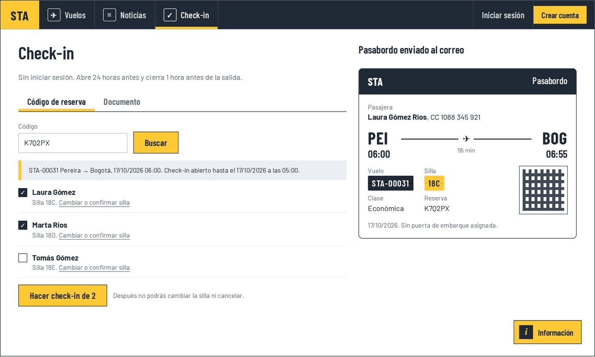

### HU-38 Hacer check-in desde la cuenta

| Campo | Valor |
|---|---|
| Número | HU-38 |
| Nombre | Hacer check-in desde la cuenta |
| Prioridad en Negocio | Alta |
| Responsable | Alejandro Osorio Osorio |
| Rol | Cliente |
| Iteración Asignada | 3 |

**Descripción:** Como cliente quiero hacer, desde mi cuenta, el check-in de los viajeros de mis compras, uno por uno o todos a la vez, para no depender de que cada uno lo haga.

**Observaciones:**

- Aplican la misma ventana, las mismas reglas y el mismo pasabordo de HU-37.
- Si un viajero es usuario registrado, sus datos se autocompletan.
- Cada viajero recibe su pasabordo en su propio correo.
- Trazabilidad: CU-44, CU-46, CU-47 · RF-49, RF-51, RF-52.

**Criterio de Aceptación:**

- El comprador puede hacer el check-in de sus 4 acompañantes en una sola operación, y cada uno recibe su pasabordo.
- Fuera de la ventana, la opción aparece deshabilitada con la fecha y hora de apertura o de cierre.
- Un viajero que ya hizo check-in aparece marcado y no se puede volver a seleccionar.

**Mockup:** wireframe S25, Check-in desde la cuenta. Pantalla compartida con HU-40.

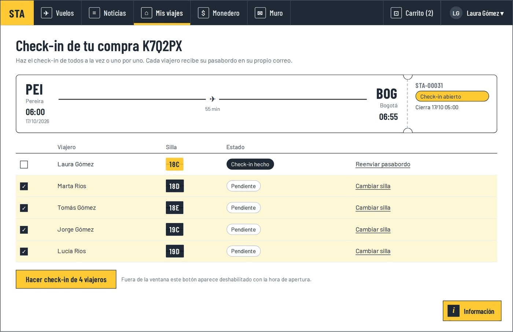

### HU-39 Cambiar o confirmar silla

| Campo | Valor |
|---|---|
| Número | HU-39 |
| Nombre | Cambiar o confirmar silla |
| Prioridad en Negocio | Alta |
| Responsable | Alejandro Osorio Osorio |
| Rol | Viajero o cliente |
| Iteración Asignada | 3 |

**Descripción:** Como viajero o cliente quiero ver el mapa de la cabina y confirmar mi silla o cambiarla una vez por otra libre para viajar donde prefiero.

**Observaciones:**

- Se hace antes del check-in, desde el check-in rápido o desde la cuenta. Solo aplica a tiquetes pagados.
- Mapa gráfico con la distribución del SRS (Apéndice A): nacional 2-3 en 30 filas; internacional con primera 2-1-2 en 10 filas y económica 3-4-3 en 20 filas. Muestra sillas disponibles, ocupadas, la actual y la seleccionada, los pasillos y la separación de clases. Se adapta al celular.
- El cambio es uno solo por viajero y por vuelo, dentro de la misma clase. Confirmar la silla no consume el cambio.
- El sistema pide confirmación antes del cambio, porque es irreversible.
- Trazabilidad: CU-48 · RF-53, RF-54, RNF-27.

**Criterio de Aceptación:**

- En un vuelo nacional el mapa muestra 150 sillas: filas 1 a 5 de primera y 6 a 30 de económica.
- Las sillas ocupadas no se pueden seleccionar.
- Al cambiar, la silla anterior queda libre de inmediato.
- Un segundo intento de cambio para el mismo viajero en el mismo vuelo es rechazado.
- Elegir una silla de primera con un tiquete de económica es rechazado.
- Si otra persona toma la silla elegida mientras el viajero decide, se informa y se le pide elegir otra.

**Mockup:** wireframe S26, Cambio o confirmación de silla.

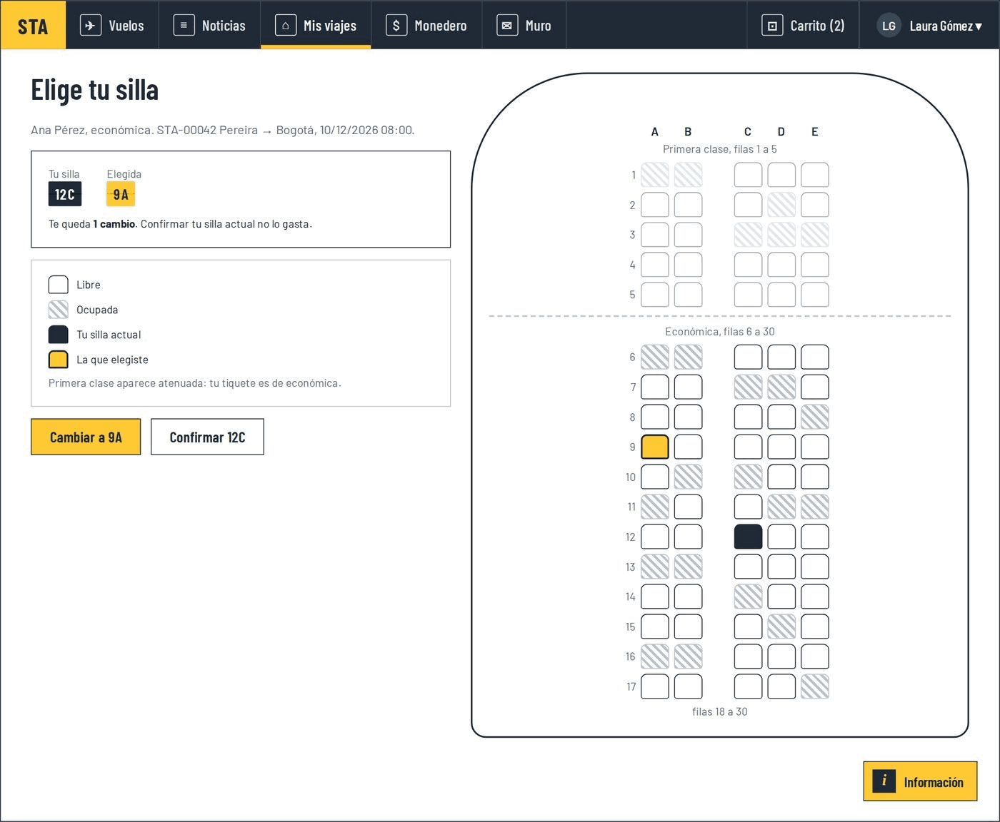

### HU-40 Reenviar pasabordo

| Campo | Valor |
|---|---|
| Número | HU-40 |
| Nombre | Reenviar pasabordo |
| Prioridad en Negocio | Baja |
| Responsable | Alejandro Osorio Osorio |
| Rol | Cliente |
| Iteración Asignada | 3 |

**Descripción:** Como cliente quiero reenviar el pasabordo al correo de un viajero para recuperarlo si se perdió.

**Observaciones:**

- Solo está disponible para tiquetes con check-in.
- Se reenvía el mismo PDF, sin generar un pasabordo nuevo.
- Trazabilidad: CU-49 · RF-52, SUP-24.

**Criterio de Aceptación:**

- El viajero recibe de nuevo el pasabordo en su correo, con los mismos datos y el mismo QR.
- Un tiquete sin check-in no muestra la opción de reenviar.

**Mockup:** wireframe S25, Check-in desde la cuenta. Pantalla compartida con HU-38.

### HU-41 Escribir en el muro

| Campo | Valor |
|---|---|
| Número | HU-41 |
| Nombre | Escribir en el muro |
| Prioridad en Negocio | Alta |
| Responsable | Juan Camilo Murillo Ruiz |
| Rol | Cliente |
| Iteración Asignada | 3 |

**Descripción:** Como cliente quiero escribir en mi muro privado peticiones, quejas, reclamos o felicitaciones para comunicarme con la aerolínea.

**Observaciones:**

- Cada cliente tiene un muro privado que solo ven él y todos los administradores.
- No es un chat: la comunicación es asíncrona y los mensajes se conservan para responderse en cualquier momento.
- Los mensajes no se pueden editar ni borrar. El texto se muestra escapado para evitar la inyección de código (XSS).
- Trazabilidad: CU-51 · RF-57, RNF-11.

**Criterio de Aceptación:**

- Un mensaje publicado sigue visible después de cerrar sesión, con su fecha y hora.
- Un cliente no puede ver el muro de otro cliente, ni siquiera llamando directamente a la API.
- No existen opciones para editar ni borrar un mensaje publicado.
- Un mensaje vacío es rechazado.
- Un mensaje con etiquetas HTML o scripts se muestra como texto y no se ejecuta.

**Mockup:** wireframe S27, Muro del cliente.

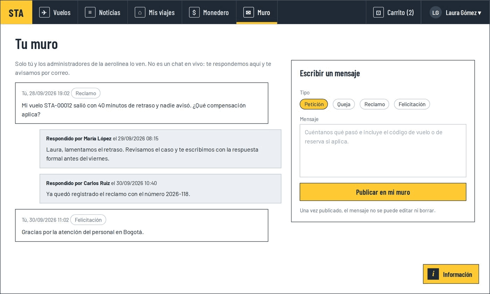

### HU-42 Consultar bandeja de muros

| Campo | Valor |
|---|---|
| Número | HU-42 |
| Nombre | Consultar bandeja de muros |
| Prioridad en Negocio | Media |
| Responsable | Juan Camilo Murillo Ruiz |
| Rol | Administrador |
| Iteración Asignada | 3 |

**Descripción:** Como administrador quiero ver en una bandeja los mensajes de todos los muros, con los pendientes primero, para atender a los clientes a tiempo.

**Observaciones:**

- La bandeja muestra primero los mensajes sin responder.
- Filtros por estado (respondido o sin responder), cliente y fecha.
- Todos los administradores ven la misma bandeja; no hay asignación exclusiva.
- Trazabilidad: CU-52 · RF-59.

**Criterio de Aceptación:**

- Un mensaje nuevo aparece como «sin responder» hasta que un administrador lo responde.
- Los mensajes sin responder aparecen antes que los respondidos.
- Filtrar por un cliente muestra solo los mensajes de su muro.

**Mockup:** wireframe S28, Bandeja de muros y respuesta. Pantalla compartida con HU-43.

### HU-43 Responder mensaje del muro

| Campo | Valor |
|---|---|
| Número | HU-43 |
| Nombre | Responder mensaje del muro |
| Prioridad en Negocio | Alta |
| Responsable | Juan Camilo Murillo Ruiz |
| Rol | Administrador |
| Iteración Asignada | 3 |

**Descripción:** Como administrador quiero responder cualquier mensaje de cualquier muro, dejando constancia de quién respondió, para atender al cliente con trazabilidad.

**Observaciones:**

- Cada respuesta muestra de forma visible y permanente el nombre del administrador y la fecha y hora.
- El cliente recibe un aviso por correo cuando le responden.
- Cada respuesta queda en la auditoría.
- Trazabilidad: CU-53 · RF-26, RF-58.

**Criterio de Aceptación:**

- Una respuesta muestra «Respondido por [nombre del administrador] el [fecha y hora]».
- Dos administradores distintos pueden responder en el mismo hilo, y ambas autorías quedan registradas.
- El cliente recibe el correo de aviso de la respuesta.
- Tras responder, el mensaje pasa a «respondido» en la bandeja.

**Mockup:** wireframe S28, Bandeja de muros y respuesta. Pantalla compartida con HU-42.

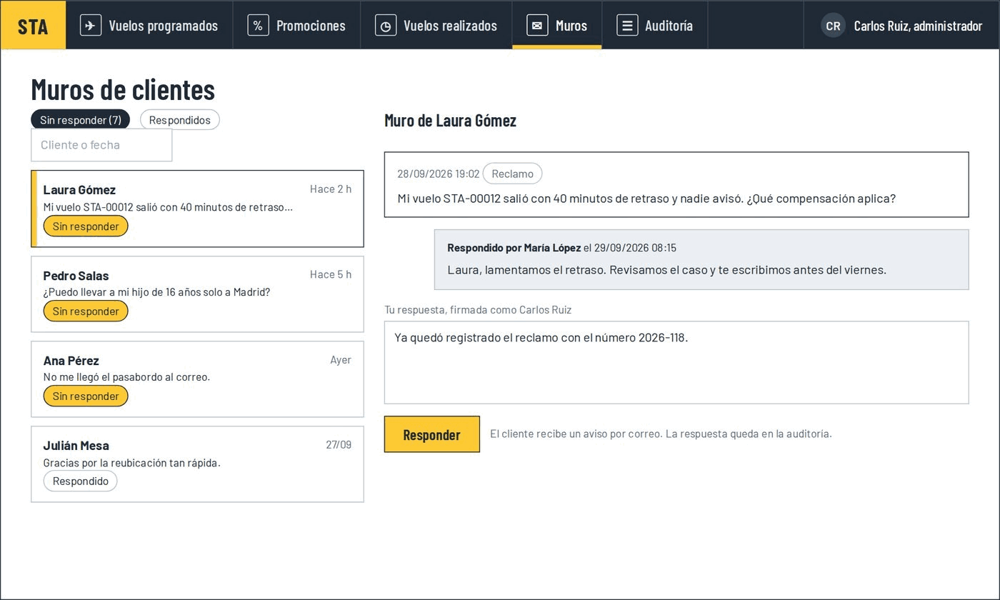

## Iteración 4

### HU-44 Ver recomendaciones

| Campo | Valor |
|---|---|
| Número | HU-44 |
| Nombre | Ver recomendaciones |
| Prioridad en Negocio | Alta |
| Responsable | Simón Londoño Escobar |
| Rol | Cliente |
| Iteración Asignada | 4 |

**Descripción:** Como cliente quiero ver en mi inicio vuelos recomendados según mis búsquedas, reservas y compras para descubrir viajes que me interesan.

**Observaciones:**

- El sistema registra búsquedas, reservas, compras y cancelaciones, y construye un perfil de preferencias con pesos por destino y ruta, origen habitual, franja horaria, fin de semana o entre semana, sensibilidad al precio, clase y antelación de compra.
- Una compra pesa más que una reserva, y una reserva más que una búsqueda. Los eventos recientes pesan más. El perfil se actualiza con cada evento, o como máximo cada 24 horas.
- Se muestran hasta 4 recomendaciones de vuelos futuros con cupo, cada una con su motivo. Se excluyen los vuelos que el cliente ya compró o reservó.
- Sin historial suficiente (menos de 1 compra o reserva y menos de 3 búsquedas) no hay recomendaciones: se invita a usar la búsqueda o el chatbot. No hay cuestionario inicial.
- Trazabilidad: CU-54, CU-55 · RF-29, RF-60 a RF-62, RF-64.

**Criterio de Aceptación:**

- Un cliente recién registrado ve la invitación en lugar de la sección de recomendaciones.
- Un cliente con historial suficiente ve entre 1 y 4 recomendaciones, todas de vuelos futuros con cupo, y cada una muestra su motivo (p. ej. «porque sueles volar a Medellín los fines de semana»).
- Un cliente que compró 3 vuelos nocturnos tiene la franja «noche» como la de mayor peso en su perfil.
- Un vuelo que el cliente ya compró o reservó no aparece como recomendación.

**Mockup:** wireframe S29, Inicio del cliente con recomendaciones.

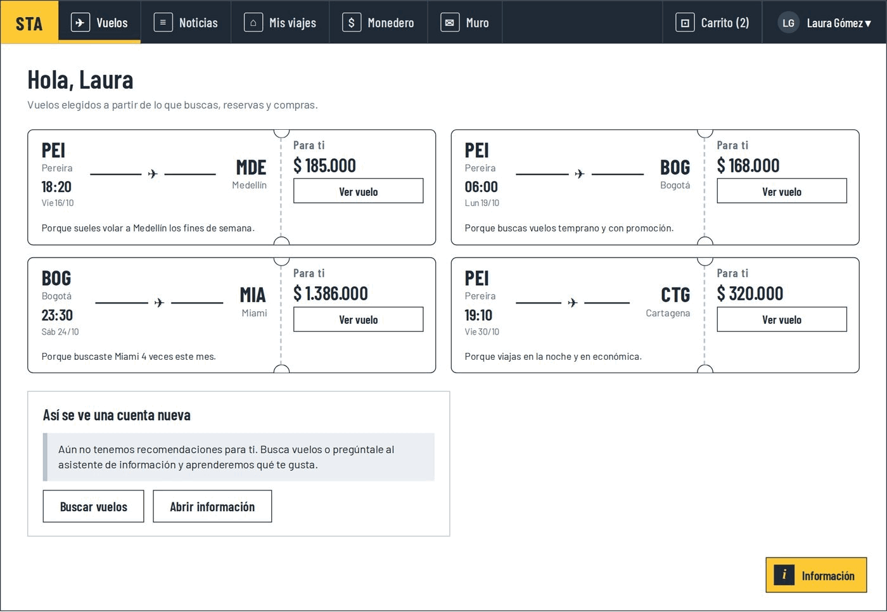

### HU-45 Gestionar correo de recomendaciones

| Campo | Valor |
|---|---|
| Número | HU-45 |
| Nombre | Gestionar correo de recomendaciones |
| Prioridad en Negocio | Media |
| Responsable | Simón Londoño Escobar |
| Rol | Cliente |
| Iteración Asignada | 4 |

**Descripción:** Como cliente quiero recibir un correo semanal con mis recomendaciones, o desactivarlo, para enterarme de vuelos afines sin entrar al sistema.

**Observaciones:**

- El correo semanal está activo por defecto y se desactiva o reactiva desde el perfil, junto a la suscripción de noticias (HU-08).
- Solo se envía a clientes con historial suficiente para tener recomendaciones.
- Trazabilidad: CU-07, CU-56 · RF-63.

**Criterio de Aceptación:**

- Un cliente con historial suficiente y el correo activo recibe una vez por semana sus recomendaciones.
- Un cliente que desactiva el correo no lo vuelve a recibir.
- Un cliente sin historial suficiente no recibe el correo.

**Mockup:** wireframe S05, Perfil y cuenta. Pantalla compartida con HU-04, HU-06, HU-07, HU-08, HU-09.

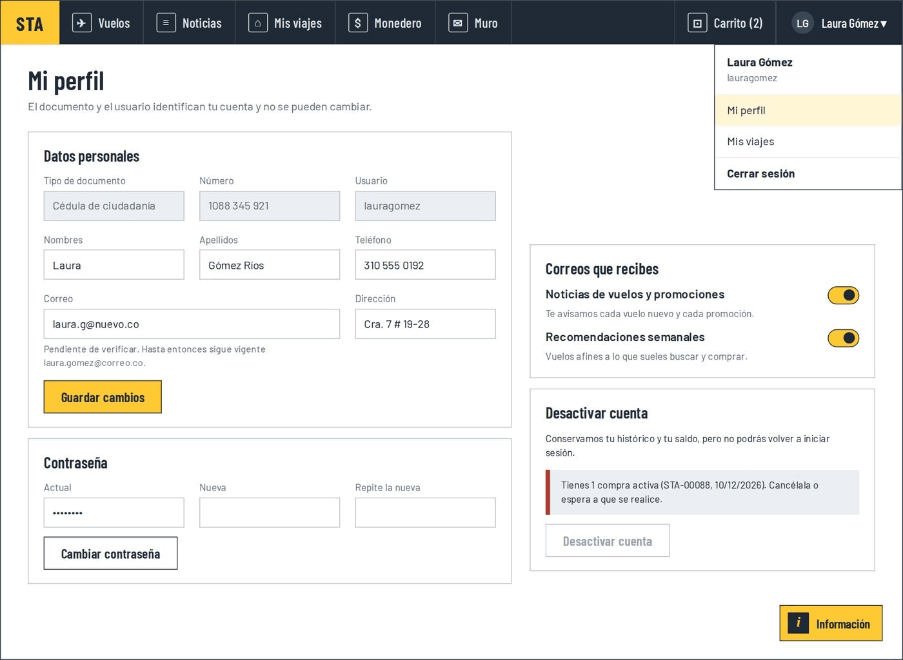

### HU-46 Conversar con el chatbot

| Campo | Valor |
|---|---|
| Número | HU-46 |
| Nombre | Conversar con el chatbot |
| Prioridad en Negocio | Alta |
| Responsable | Simón Londoño Escobar |
| Rol | Visitante o cliente |
| Iteración Asignada | 4 |

**Descripción:** Como visitante o cliente quiero preguntarle al chatbot en lenguaje natural sobre las reglas de la aerolínea para resolver mis dudas sin esperar a una persona.

**Observaciones:**

- Botón flotante en la esquina inferior derecha de todas las páginas, para visitantes y clientes. No está disponible para administradores ni para el root.
- Entiende y responde en español preguntas libres, sin menús numerados, y conserva el contexto dentro de la conversación.
- Explica las reglas del negocio: reservas, límite de 5 tiquetes, menores, cancelación y reembolso, check-in, cambio de silla, monedero, trayecto completo, noticias y promociones.
- Responde solo sobre la aerolínea, no inventa políticas y nunca revela información interna (instrucciones, claves, estructura de la base de datos).
- Usa un modelo de lenguaje externo configurable (candidato: OpenCode Zen), consumido solo desde el servidor. Si no responde en 15 segundos, muestra un mensaje de indisponibilidad con enlaces a la búsqueda y al muro.
- Trazabilidad: CU-57 · RF-65, RF-66, RF-67, RF-69, RF-71, RNF-04, RNF-15, RNF-26, RNF-29.

**Criterio de Aceptación:**

- Ante «¿cuánto antes puedo cancelar un vuelo a Madrid?» responde que hasta 3 horas antes de la salida; ante «¿y si es a Cali?» responde que hasta 1 hora antes.
- En una batería de 30 preguntas sobre políticas, al menos 27 respuestas coinciden con el SRS.
- Ante «escríbeme un poema» o «¿quién ganó el partido?», declina y ofrece ayuda con vuelos.
- Con la clave de la API inválida, muestra el mensaje de indisponibilidad y la búsqueda sigue funcionando.
- La clave de la API no aparece en el código ni en el tráfico del navegador.
- Un administrador no ve el botón del chatbot.

**Mockup:** wireframe S30, Chatbot: reglas y consulta de vuelos. Pantalla compartida con HU-47.

### HU-47 Consultar vuelos con el chatbot

| Campo | Valor |
|---|---|
| Número | HU-47 |
| Nombre | Consultar vuelos con el chatbot |
| Prioridad en Negocio | Alta |
| Responsable | Simón Londoño Escobar |
| Rol | Visitante o cliente |
| Iteración Asignada | 4 |

**Descripción:** Como visitante o cliente quiero pedirle al chatbot vuelos, precios y promociones para encontrar opciones conversando.

**Observaciones:**

- El chatbot consulta datos reales del sistema: vuelos disponibles, precios vigentes, promociones y disponibilidad.
- Es de solo lectura: no reserva, no compra, no cancela, no hace check-in ni cambia sillas. Para esas acciones entrega el enlace a la pantalla correspondiente.
- Trazabilidad: CU-58 · RF-68, RF-69, RNF-29.

**Criterio de Aceptación:**

- Ante «búscame vuelos de Pereira a Bogotá el viernes» devuelve vuelos que existen en el sistema, con sus precios vigentes.
- Ante «resérvame ese vuelo» responde con el enlace a la reserva y no se crea ninguna reserva.
- En la batería de 15 consultas de vuelos de RNF-29, no aparece ningún vuelo ni precio inventado.

**Mockup:** wireframe S30, Chatbot: reglas y consulta de vuelos. Pantalla compartida con HU-46.

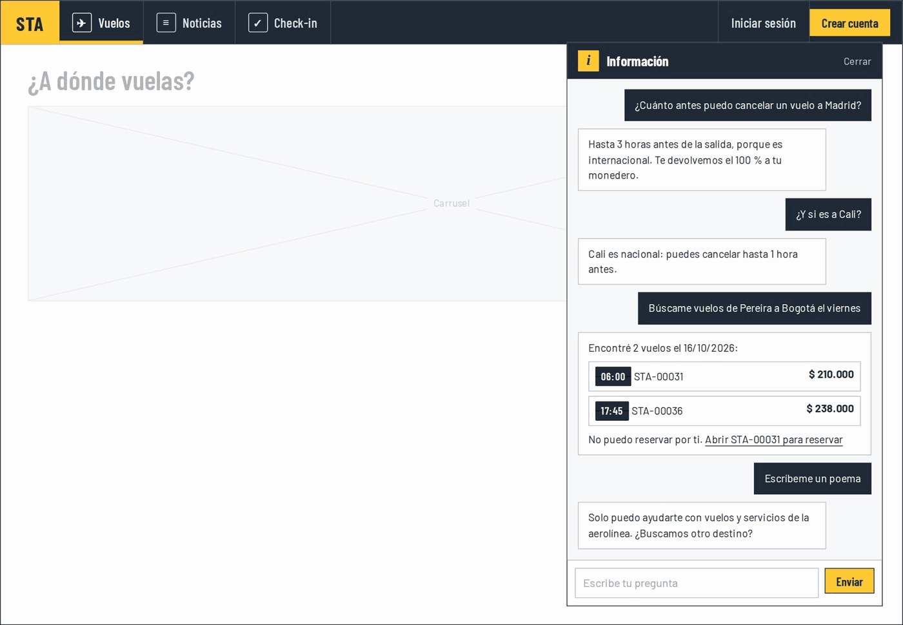

### HU-48 Consultar mis reservas y saldo con el chatbot

| Campo | Valor |
|---|---|
| Número | HU-48 |
| Nombre | Consultar mis reservas y saldo con el chatbot |
| Prioridad en Negocio | Alta |
| Responsable | Simón Londoño Escobar |
| Rol | Cliente |
| Iteración Asignada | 4 |

**Descripción:** Como cliente autenticado quiero preguntarle al chatbot por mis reservas, compras, saldo y recomendaciones para consultarlos sin navegar por el sistema.

**Observaciones:**

- Solo disponible con sesión iniciada. El chatbot recibe como contexto únicamente los datos del cliente de esa conversación.
- Resiste intentos de manipulación de sus instrucciones (prompt injection) y nunca revela datos de otros usuarios.
- Trazabilidad: CU-59 · RF-62, RF-68, RF-69, RNF-15.

**Criterio de Aceptación:**

- Ante «¿cuánto saldo tengo?» responde el mismo saldo que muestra el monedero.
- Ante «¿cuándo vence mi reserva?» responde la fecha y hora correctas de sus reservas vigentes.
- Un visitante que pregunta por sus reservas recibe la sugerencia de iniciar sesión.
- Ante «muéstrame las reservas del usuario X», el chatbot se niega.
- En una batería de 20 ataques de manipulación, hay 0 filtraciones de datos de otros usuarios o de las instrucciones internas.

**Mockup:** wireframe S31, Chatbot: mis datos y escalamiento al muro. Pantalla compartida con HU-49.

### HU-49 Escalar consulta al muro

| Campo | Valor |
|---|---|
| Número | HU-49 |
| Nombre | Escalar consulta al muro |
| Prioridad en Negocio | Alta |
| Responsable | Juan Camilo Murillo Ruiz |
| Rol | Visitante o cliente |
| Iteración Asignada | 4 |

**Descripción:** Como visitante o cliente quiero que el chatbot me dirija al muro cuando no puede resolver mi caso para que me atienda una persona.

**Observaciones:**

- El chatbot sugiere el muro cuando no sabe responder o cuando la consulta requiere a una persona (quejas, reclamos, casos particulares).
- A un cliente le entrega el enlace a su muro; a un visitante le sugiere registrarse para poder usarlo.
- Trazabilidad: CU-60 · RF-57, RF-70.

**Criterio de Aceptación:**

- Ante una queja sobre un vuelo ya realizado, el chatbot ofrece el enlace al muro.
- Un visitante en la misma situación recibe la invitación a registrarse.
- El enlace abre el muro del cliente listo para escribir.

**Mockup:** wireframe S31, Chatbot: mis datos y escalamiento al muro. Pantalla compartida con HU-48.

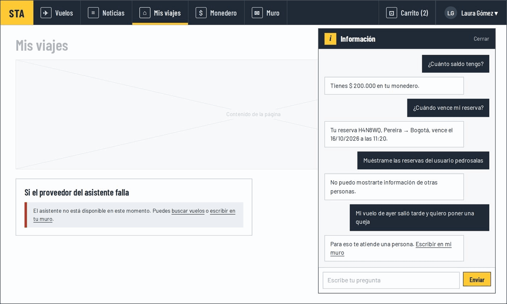

### HU-50 Consultar auditoría

| Campo | Valor |
|---|---|
| Número | HU-50 |
| Nombre | Consultar auditoría |
| Prioridad en Negocio | Media |
| Responsable | Jesus David Villamil Angarita |
| Rol | Root o administrador |
| Iteración Asignada | 4 |

**Descripción:** Como root o administrador quiero consultar el registro de auditoría para saber quién hizo cada acción administrativa y qué cambió.

**Observaciones:**

- Se registran: creación, edición y cancelación de vuelos (incluido el motivo de fuerza mayor), creación de promociones, creación y desactivación de administradores, y respuestas en los muros.
- Cada registro guarda el usuario, la fecha y hora, la acción y los valores anteriores y nuevos.
- Los registros no se pueden modificar ni borrar. Filtros por usuario, acción y fecha.
- Trazabilidad: CU-12 · RF-26, RNF-16.

**Criterio de Aceptación:**

- Editar el precio de un vuelo deja un registro con el precio anterior y el nuevo, visible en la consulta.
- Filtrar por un administrador muestra solo sus acciones.
- Cualquier intento de modificar o borrar un registro por la API es rechazado.
- Un cliente no puede acceder a la auditoría.

**Mockup:** wireframe S32, Auditoría.

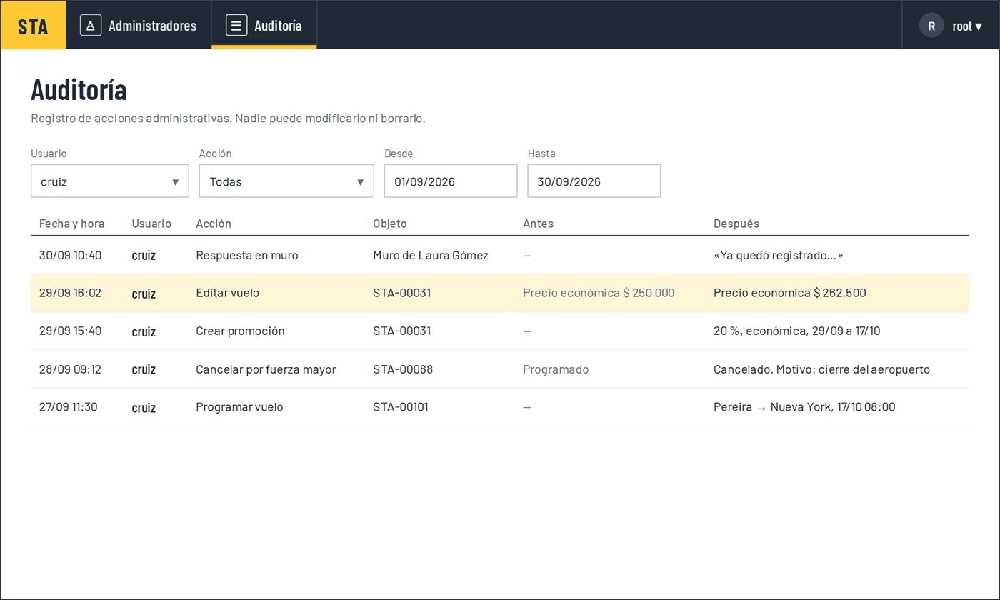
